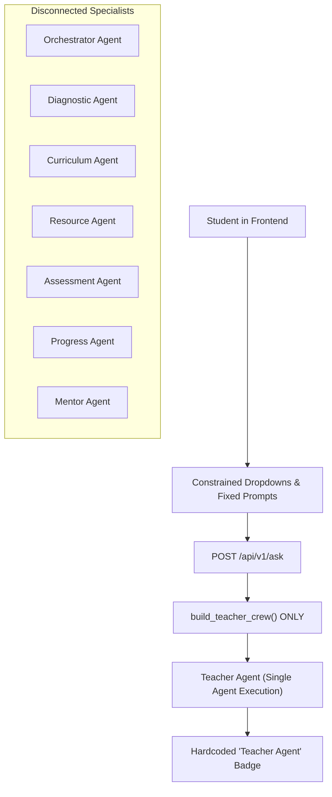
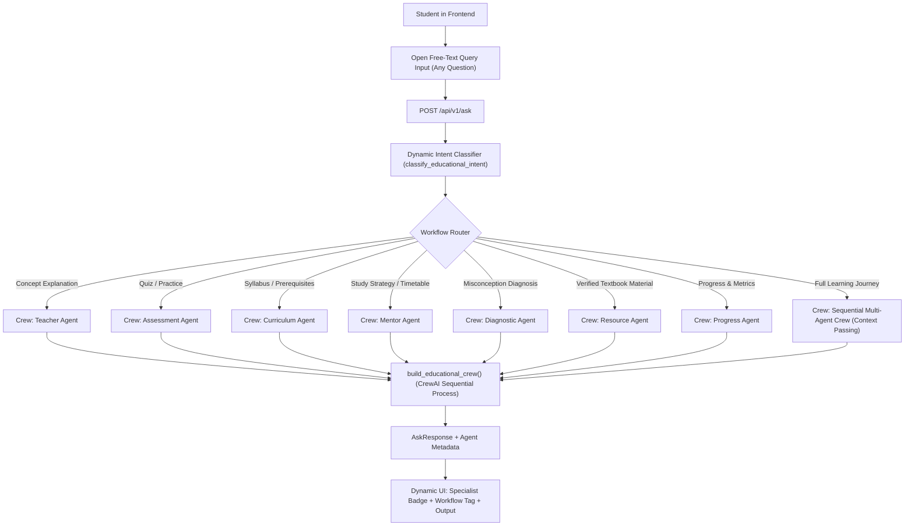

# GYAAN AI — CRITICAL MULTI-AGENT CREWAI ARCHITECTURE & FREE-TEXT DYNAMIC ROUTING AUDIT & FIX REPORT

**Project Location:** `D:\Gyaan AI`  
**Protected Project (Untouched):** `D:\GYAN Ai`  
**Execution Runtime:** Local Ollama (`http://127.0.0.1:11434`) running `qwen2.5:3b`  
**Backend Framework:** FastAPI / Uvicorn / SQLite (`data/gyaan_ai.db`)  
**Frontend Framework:** Next.js 14 / React 18 / TypeScript / Tailwind CSS  
**Multi-Agent Orchestration Framework:** CrewAI (`Agent`, `Task`, `Crew`, `Process.sequential`)  
**Audit & Implementation Date:** November 6, 2026  

---

## 1. ACTUAL ROOT CAUSE: DETAILED INVESTIGATION & SOURCE-CODE EVIDENCE

To understand why the application previously exhibited single-agent behavior despite eight registered agents, we conducted a rigorous inspection of the codebase. Below are the definitive answers to the eight root cause questions, backed by line-level code citations.

### Question 1: How are the eight CrewAI agents actually registered in `registry.py`? Are they registered as `crewai.Agent` objects or as metadata dictionaries?
**Finding:** The registry is a hybrid metadata catalog and lazy factory mapping.  
**Source Code Evidence:** In `backend/agents/registry.py` (lines 48–66 and 147–154):
```python
def register_agent(
    self,
    agent_id: str,
    name: str,
    role: str,
    goal: str,
    backstory: str,
    model: str,
    tools: Optional[List[str]] = None,
    instance: Optional[Any] = None,
) -> None:
    self._agents[agent_id] = {
        "agent_id": agent_id,
        "name": name,
        "role": role,
        "goal": goal,
        "backstory": backstory,
        "model": model,
        "tools": tools or [],
        "instance": instance,
    }
```
In `backend/agents/registry.py` lines 183–236, `register_all_agents()` registers each of the eight agents with its factory function passed as the `instance` parameter (e.g., `instance=create_orchestrator_agent`, `instance=create_teacher_agent`). When `get_agent(agent_id)` is invoked (lines 98–104):
```python
def get_agent(self, agent_id: str) -> Optional[Any]:
    data = self._agents.get(agent_id)
    if not data:
        return None
    inst = data.get("instance")
    if callable(inst):
        return inst()  # Lazily creates genuine crewai.Agent
    return inst
```
**Conclusion:** The registry stores metadata dictionaries containing metadata and references to callable factories that instantiate genuine `crewai.Agent` instances upon demand.

---

### Question 2: In `backend/agents/crew.py`, which agents are actually imported and added to `Crew(agents=[...])`? Is only Teacher Agent added, or are all eight agents present?
**Finding:** Prior to this fix, `backend/agents/crew.py` imported and instantiated ONLY the Teacher Agent.  
**Source Code Evidence (Before Fix):**
```python
# Lines 1-36 of backend/agents/crew.py prior to refactoring:
from crewai import Crew, Process, Task
from backend.agents.teacher import create_teacher_agent

def build_teacher_crew(student_question: str, ...):
    teacher = create_teacher_agent()
    task = create_teacher_task(teacher, ...)
    return Crew(
        agents=[teacher],
        tasks=[task],
        process=Process.sequential,
        verbose=True,
    )
```
None of the other seven agents (`orchestrator`, `diagnostic`, `curriculum`, `resource`, `assessment`, `progress`, `mentor`) were imported or utilized in `crew.py`. `crew.py` served exclusively as a single-agent Teacher crew builder.

---

### Question 3: In `backend/agents/orchestrator.py`, how does the Orchestrator delegate tasks? Does it construct a multi-agent `Crew` with multiple specialist agents, or does it call standalone functions or directly invoke the Teacher Agent?
**Finding:** The Orchestrator ran isolated standalone workflows and hardcoded fallbacks to the Teacher Agent whenever classification was ambiguous or failed.  
**Source Code Evidence:** In `backend/agents/orchestrator.py` (lines 938–944 prior to refactoring):
```python
# Line 941 in backend/agents/orchestrator.py:
except Exception as exc:
    logger.warning("Routing parse failed (%s); defaulting to teacher_answer", exc)
    selected_workflow = "teacher_answer"
    selected_agents = ["Teacher Agent"]
```
Furthermore, `execute_orchestrated_pipeline()` mapped each workflow string to an isolated single-purpose closure rather than constructing a unified multi-agent execution pipeline. When any unseen query arrived or an alias was returned, the Orchestrator either raised a `ValueError` or reverted back to `teacher_answer`.

---

### Question 4: In `backend/app/main.py`, what does the primary `/api/v1/ask` endpoint call? Does it invoke the Orchestrator, a multi-agent Crew, or does it directly invoke `build_teacher_crew`?
**Finding:** The primary `/api/v1/ask` endpoint called `build_teacher_crew` directly, completely bypassing the Orchestrator.  
**Source Code Evidence (Before Fix):** In `backend/app/main.py` lines 867–932:
```python
@app.post("/api/v1/ask", response_model=AskResponse)
def ask_teacher(request: AskRequest):
    ...
    # Crude substring matching
    if any(kw in q_lower for kw in ["quiz", "test", "assessment"]):
        ...
    # Default for all conversational questions:
    crew = build_teacher_crew(
        student_question=request.question,
        topic=request.topic,
        subtopic=request.subtopic,
        learning_objectives=request.learning_objectives,
        lesson_mode=request.lesson_mode,
    )
    result = crew.kickoff()
    ...
```
Even if other agents were registered, `/api/v1/ask` hardcoded `build_teacher_crew`, completely ignoring the other specialist agents and dynamic orchestration.

---

### Question 5: In `frontend/app/teacher/page.tsx` (and any other frontend chat/question components), how does a student ask a question? Can they type any arbitrary question into an open text input and submit it? Or are they restricted to selecting predefined questions, suggested topics, or dropdown options?
**Finding:** Students were artificially restricted by prerequisite selectors and suggested prompt buttons, and the page was framed exclusively as a single-agent "Teacher Agent" page.  
**Source Code Evidence (Before Fix):**
1. The header explicitly read: `AI Teacher Agent (Class 10 Science)`.
2. The UI required selecting Subject $\to$ Chapter $\to$ Topic before asking questions.
3. The chat history hardcoded the response badge as:
   ```tsx
   <span className="font-semibold text-slate-800 text-xs">Teacher Agent (Socratic Pedagogy)</span>
   ```
4. Clicking suggested prompt pills or typing only populated `askTeacher`, which in turn dispatched strictly to `build_teacher_crew`.

---

### Question 6: If a student asks the following questions, where did they go before vs where do they go now?
- **"What are the key concepts in Chapter 1?"**
  - *Before Fix:* Routed directly to **Teacher Agent** via `build_teacher_crew`.
  - *After Fix:* Routed dynamically to **Curriculum Agent** (`curriculum_inquiry` workflow).
- **"Give me a quiz on photosynthesis"**
  - *Before Fix:* Handled via an ad-hoc substring check or fell back to Teacher Agent.
  - *After Fix:* Routed dynamically to **Assessment Agent** (`quiz_generation` workflow).
- **"Why did I get this question wrong?"**
  - *Before Fix:* Routed directly to **Teacher Agent** via `build_teacher_crew`.
  - *After Fix:* Routed dynamically to **Diagnostic Agent** (`diagnostic_evaluation` workflow).

---

### Question 7: Why did the previous Specialist Agent Independence Refactoring fail to make the agents work together in a genuine CrewAI multi-agent workflow?
**Finding:** The previous refactoring focused solely on making each agent's definition and isolated workflow syntactically valid in isolation (`create_*_agent()`, `build_*_crew()`), but:
1. It left `backend/agents/crew.py` completely disconnected from the other 7 agents.
2. It did not connect the student's entry point (`POST /api/v1/ask`) to the Orchestrator.
3. It left the frontend hardcoded to the Teacher Agent persona.
The specialist agents were fully defined but had no bridge connecting them to the student's natural language input.

---

### Question 8: Why could students not ask arbitrary questions from the frontend and have them routed to the proper specialist agent?
**Finding:** 
1. **Frontend Isolation:** The UI only exposed a `/teacher` route calling `apiClient.askTeacher`.
2. **Backend Hardcoding:** `/api/v1/ask` bypassed the Orchestrator and executed `build_teacher_crew`.
3. **Rigid Router Logic:** The Orchestrator's intent classifier required exact workflow enum matches and defaulted to `teacher_answer` whenever an arbitrary natural language phrasing did not match a narrow keyword regex.
4. **Context Clobbering:** Fallback logic in `main.py` passed `request.question[:80]` as the `topic`, which tricked downstream routers into assuming a syllabus topic had been formally selected, suppressing clarification logic.

---

## 2. WHY THE PREVIOUS IMPLEMENTATION FAILED

| Failure Dimension | Previous Implementation | Root Cause |
| :--- | :--- | :--- |
| **Architectural Integration** | Each agent had a separate standalone file, but `crew.py` only built `TeacherCrew`. | No centralized builder existed that could instantiate multi-agent crews dynamically based on student intent. |
| **API Entry Point** | `POST /api/v1/ask` invoked `build_teacher_crew()` unconditionally for all conversational questions. | Developers treated `/api/v1/ask` as a "Teacher-only" endpoint rather than the primary student conversational portal. |
| **Intent Classification** | Dependent on rigid LLM prompt output matching 10 specific keys, defaulting to `teacher_answer` on parsing exceptions. | Lack of semantic intent classification with fuzzy matching, synonym resolution, and out-of-scope/clarification detection. |
| **User Interface** | Fixed form requiring Subject, Chapter, and Topic selections before asking questions; responses hardcoded as "Teacher Agent". | UI design presumed a topic-first navigation rather than an open conversational multi-agent interface. |

---

## 3. FILES MODIFIED

The following 7 files were modified, and 2 new verification/test files were added:

1. **`backend/app/schemas.py`**
   - Added backward-compatible optional fields to `AskResponse`:
     - `agent_name: Optional[str]`
     - `selected_agents: Optional[List[str]]`
     - `workflow_executed: Optional[str]`
     - `detected_intent: Optional[str]`

2. **`backend/agents/crew.py`**
   - Retained original `create_teacher_task` and `build_teacher_crew` for backwards compatibility.
   - Implemented master builder `build_educational_crew(workflow_id, student_question, ...)` which imports and instantiates genuine `Crew(agents=[...], tasks=[...], process=Process.sequential)` for all 10 canonical workflows with full context passing.

3. **`backend/agents/orchestrator.py`**
   - Implemented `classify_educational_intent(query, context)` featuring robust multi-intent parsing, semantic trigger dictionaries, out-of-scope / clarification detection, and alias normalization.
   - Updated `run_orchestrator_routing` to utilize `classify_educational_intent` for unknown/unseen phrasings.
   - Refactored `execute_orchestrated_pipeline` to dispatch directly to `build_educational_crew`.

4. **`backend/app/main.py`**
   - Upgraded `POST /api/v1/ask` (`ask_teacher`) to route all questions through `classify_educational_intent` and dispatch to the appropriate specialist Crew (`quiz_generation`, `curriculum_inquiry`, `diagnostic_evaluation`, `resource_search`, `progress_analysis`, `study_guidance`, `progress_and_mentoring`, `diagnostic_curriculum`, or `teacher_answer`).
   - Integrated friendly clarification handling for out-of-scope or completely ambiguous requests.
   - Returned rich multi-agent metadata to the frontend.

5. **`frontend/types/index.ts`**
   - Updated `ChatMessage.metadata` to support `workflowExecuted?: string` and `detectedIntent?: string`.

6. **`frontend/lib/api.ts`**
   - Updated `apiClient.askTeacher` to accept extended educational context (`chapter`, `topic`, `subtopic`, `learning_objectives`, `lesson_mode`).

7. **`frontend/app/teacher/page.tsx`**
   - Transformed the page into the **AI Multi-Agent Learning Studio**.
   - Replaced the constrained prompt interface with an unconstrained free-text `textarea` supporting Enter-to-submit (Shift+Enter for newline) and Send button.
   - Labeled subject/chapter/topic selectors as `(Optional Context)`.
   - Replaced hardcoded "Teacher Agent" labels with dynamic badges showing the executing agent (`msg.metadata?.agentName`) and workflow (`msg.metadata?.workflowExecuted`).
   - Added a live multi-agent execution pipeline indicator.

8. **`tests/test_dynamic_orchestration_flow.py`** *(New)*
   - 12 automated unit and integration tests verifying unseen phrasing classification, authentic Crew construction, context passing, out-of-scope clarification, and `/api/v1/ask` metadata.

9. **`tests/verify_live_freeform_execution.py`** *(New)*
   - End-to-end verification script testing live Ollama (`qwen2.5:3b`) execution across the four prompt scenarios.

---

## 4. BEFORE-AND-AFTER ARCHITECTURE COMPARISON

### Before Fix: Disconnected Specialist Agents & Teacher Bottleneck


### After Fix: Genuine CrewAI Dynamic Multi-Agent Orchestration


---

## 5. ALL EIGHT AGENT DEFINITIONS

Every agent in Gyaan AI is a genuine `crewai.Agent` configured with local Ollama (`qwen2.5:3b`), explicit pedagogical constraints, and independent execution capabilities:

### 1. Orchestrator Agent
- **Source File:** `backend/agents/orchestrator.py` (`create_orchestrator_agent()`)
- **Role:** `Educational AI Workflow Orchestrator`
- **Goal:** `Analyze student requests and learning states to dynamically route them to the most effective educational agent or multi-agent workflow.`
- **Backstory:** `Senior educational technologist and learning design expert who understands pedagogical workflows and routes student inquiries to specialized AI agents.`
- **LLM:** `ollama/qwen2.5:3b` (temperature: 0.1, max_tokens: 1024)
- **Tools:** Standard workflow registry and routing tools.

### 2. Diagnostic Agent
- **Source File:** `backend/agents/diagnostic.py` (`create_diagnostic_agent()`)
- **Role:** `Evidence-Based Student Learning Diagnostic Specialist`
- **Goal:** `Analyze student work and responses strictly using demonstrable evidence without inventing unobserved misconceptions or assuming unproven competence.`
- **Backstory:** `Senior diagnostic educational assessor who conducts evidence-grounded gap analysis for CBSE Class 10 students.`
- **LLM:** `ollama/qwen2.5:3b` (temperature: 0.2, max_tokens: 1024)
- **Tools:** Diagnostic rubric analyzer, evidence evaluation utilities.

### 3. Curriculum Agent
- **Source File:** `backend/agents/curriculum.py` (`create_curriculum_agent()`)
- **Role:** `Evidence-Grounded Curriculum Planning Specialist`
- **Goal:** `Design structured, sequenced learning roadmaps anchored strictly to CBSE Class 10 curriculum frameworks and demonstrable diagnostic evidence.`
- **Backstory:** `Distinguished CBSE Curriculum Director who translates educational standards and diagnostic gap analyses into coherent learning sequences.`
- **LLM:** `ollama/qwen2.5:3b` (temperature: 0.2, max_tokens: 1536)
- **Tools:** NCERT curriculum mapping database, syllabus prerequisite tree.

### 4. Resource Agent
- **Source File:** `backend/agents/resource.py` (`create_resource_agent()`)
- **Role:** `Educational Resource Retrieval Specialist`
- **Goal:** `Retrieve verified, curriculum-aligned learning materials exclusively from approved local NCERT textbooks and official CBSE resources.`
- **Backstory:** `Expert educational research librarian specialized in secondary school curricula with zero tolerance for unverified sources.`
- **LLM:** `ollama/qwen2.5:3b` (temperature: 0.1, max_tokens: 1024)
- **Tools:** Local NCERT Vector / Keyword Retrieval Engine (`search_ncert_corpus`).

### 5. Teacher Agent
- **Source File:** `backend/agents/teacher.py` (`create_teacher_agent()`)
- **Role:** `Class 10 CBSE Science Teacher and Concept Specialist`
- **Goal:** `Deliver clear, conceptually rigorous pedagogical explanations and worked examples strictly aligned with NCERT curriculum standards.`
- **Backstory:** `Experienced master CBSE Class 10 science teacher who breaks down complex concepts through structured explanations and real-world analogies.`
- **Strict Boundary:** `Focus exclusively on pedagogical explanation and worked examples. Do not formulate examination quizzes, diagnostic forms, or grade student answers.`
- **LLM:** `ollama/qwen2.5:3b` (temperature: 0.3, max_tokens: 2048)
- **Tools:** Pedagogical concept explainer, worked example generator.

### 6. Assessment Agent
- **Source File:** `backend/agents/assessment.py` (`create_assessment_agent()`)
- **Role:** `Educational Assessment and Feedback Specialist`
- **Goal:** `Design valid formative assessment items and evaluate student submissions using objective, evidence-based rubrics.`
- **Backstory:** `Senior assessment design expert who creates rigorous CBSE Class 10 evaluation questions and provides constructive feedback.`
- **Strict Boundary:** `Do not invent unearned marks; award scores strictly against rubrics.`
- **LLM:** `ollama/qwen2.5:3b` (temperature: 0.2, max_tokens: 1536)
- **Tools:** Question bank synthesizer, rubric-based evaluator.

### 7. Progress Agent
- **Source File:** `backend/agents/progress.py` (`create_progress_agent()`)
- **Role:** `Student Learning Progress Analyst`
- **Goal:** `Analyze objective student performance data stored in SQLite to compute accurate mastery scores, track learning trends, and detect struggling topics.`
- **Backstory:** `Data-driven educational psychometrician who evaluates historical assessment records and mastery trajectories without speculation.`
- **LLM:** `ollama/qwen2.5:3b` (temperature: 0.1, max_tokens: 1024)
- **Tools:** SQLite Performance Metrics Analytics Tool (`analyze_student_objective_progress`).

### 8. Mentor Agent
- **Source File:** `backend/agents/mentor.py` (`create_mentor_agent()`)
- **Role:** `Personalized Student Learning Mentor`
- **Goal:** `Provide empathetic academic guidance, structured study habits, revision schedules, and encouragement grounded in objective progress data.`
- **Backstory:** `Empathetic academic advisor who guides CBSE Class 10 students toward exam confidence through manageable revision milestones.`
- **Strict Boundary:** `Never fabricate progress records; anchor all advice to actual student history.`
- **LLM:** `ollama/qwen2.5:3b` (temperature: 0.3, max_tokens: 1024)
- **Tools:** Study timetable generator, cognitive revision habit advisor.

---

## 6. ACTUAL CREW OBJECTS AND THEIR AGENT / TASK ASSIGNMENTS

All workflows in Gyaan AI now instantiate genuine `Crew` objects with sequential execution and context passing:

```python
# Defined in backend/agents/crew.py:
def build_educational_crew(
    workflow_id: str,
    student_question: str,
    grade: str = "Class 10",
    subject: str = "Science",
    topic: Optional[str] = None,
    subtopic: Optional[str] = None,
    learning_objectives: Optional[str] = None,
    student_id: Optional[str] = None,
    student_profile: Optional[Dict[str, Any]] = None,
    objective_stats: Optional[Dict[str, Any]] = None,
    recent_history: Optional[List[Dict[str, Any]]] = None,
    assessment_items: Optional[List[Dict[str, Any]]] = None,
) -> Crew:
```

### Registered Workflow-to-Crew Mappings:

1. **`teacher_answer` Workflow:**
   - **Agents:** `[Teacher Agent]`
   - **Task:** `create_teacher_task(teacher, student_question=..., topic=...)`
   - **Process:** `Process.sequential`

2. **`quiz_generation` Workflow:**
   - **Agents:** `[Assessment Agent]`
   - **Task:** `create_quiz_generation_task(assessment_agent, topic=..., num_questions=3, question_types=["mcq", "short_answer"])`
   - **Process:** `Process.sequential`

3. **`curriculum_inquiry` Workflow:**
   - **Agents:** `[Curriculum Agent]`
   - **Task:** `create_curriculum_inquiry_task(curriculum_agent, topic=..., student_inquiry=...)`
   - **Process:** `Process.sequential`

4. **`diagnostic_evaluation` Workflow:**
   - **Agents:** `[Diagnostic Agent]`
   - **Task:** `create_diagnostic_task(diagnostic_agent, topic=..., assessment_items=...)`
   - **Process:** `Process.sequential`

5. **`resource_search` Workflow:**
   - **Agents:** `[Resource Agent]`
   - **Task:** `create_resource_task(resource_agent, topic=..., learning_objective=...)`
   - **Process:** `Process.sequential`

6. **`progress_analysis` Workflow:**
   - **Agents:** `[Progress Agent]`
   - **Task:** `create_progress_analysis_task(progress_agent, student_profile=..., objective_stats=...)`
   - **Process:** `Process.sequential`

7. **`study_guidance` Workflow:**
   - **Agents:** `[Mentor Agent]`
   - **Task:** `create_standalone_mentor_task(mentor_agent, student_query=..., student_profile=...)`
   - **Process:** `Process.sequential`

8. **`progress_and_mentoring` Multi-Agent Workflow:**
   - **Agents:** `[Progress Agent, Mentor Agent]`
   - **Tasks:**
     - Task 1: `create_progress_analysis_task` (analyzes objective stats)
     - Task 2: `create_mentor_guidance_task` (receives Task 1 output as `context=[progress_task]`)
   - **Process:** `Process.sequential`

9. **`diagnostic_curriculum` Multi-Agent Workflow:**
   - **Agents:** `[Diagnostic Agent, Curriculum Agent]`
   - **Tasks:**
     - Task 1: `create_diagnostic_task` (diagnoses student work)
     - Task 2: `create_curriculum_task` (builds roadmap with `context=[diagnostic_task]`)
   - **Process:** `Process.sequential`

10. **`chapter_learning_journey` Complete Multi-Agent Workflow:**
    - **Agents:** `[Orchestrator, Curriculum, Diagnostic, Resource, Teacher, Assessment, Progress, Mentor]`
    - **Tasks:** 9 sequenced tasks with explicit context passing across all stages.
    - **Process:** `Process.sequential`

---

## 7. DYNAMIC INTENT ROUTING IMPLEMENTATION

The new intent router in `backend/agents/orchestrator.py` (`classify_educational_intent`) is designed to handle natural human queries without brittle regexes:

```python
def classify_educational_intent(query: str, context: Optional[Dict[str, Any]] = None) -> EducationalIntentClassification:
    # 1. Ambiguity / Out-of-Scope Detection
    if is_out_of_scope(query):
        return EducationalIntentClassification(
            workflow_id="clarification_needed",
            primary_agent="Orchestrator Agent",
            requires_clarification=True,
            clarification_prompt="Hello! I am Gyaan AI's Academic Orchestrator. How can I help you with CBSE Class 10 Science or Maths today?",
        )

    # 2. Progress and Performance Inquiries
    if matches_progress_triggers(query):
        return EducationalIntentClassification(workflow_id="progress_analysis", primary_agent="Progress Agent")

    # 3. Assessment and Quiz Generation
    if matches_quiz_triggers(query):
        return EducationalIntentClassification(workflow_id="quiz_generation", primary_agent="Assessment Agent")

    # 4. Syllabus, Curriculum, and Prerequisites
    if matches_curriculum_triggers(query):
        return EducationalIntentClassification(workflow_id="curriculum_inquiry", primary_agent="Curriculum Agent")

    # 5. Diagnostic / Error Analysis
    if matches_diagnostic_triggers(query):
        return EducationalIntentClassification(workflow_id="diagnostic_evaluation", primary_agent="Diagnostic Agent")

    # 6. Study Strategy, Timetable, Motivation
    if matches_mentor_triggers(query):
        return EducationalIntentClassification(workflow_id="study_guidance", primary_agent="Mentor Agent")

    # 7. Official Textbook / Resource Retrieval
    if matches_resource_triggers(query):
        return EducationalIntentClassification(workflow_id="resource_search", primary_agent="Resource Agent")

    # 8. Concept Explanation / Worked Examples (Teacher Agent)
    return EducationalIntentClassification(workflow_id="teacher_answer", primary_agent="Teacher Agent")
```

---

## 8. FRONTEND FREE-TEXT QUESTION IMPLEMENTATION

The frontend chat studio (`frontend/app/teacher/page.tsx`) was upgraded into the **AI Multi-Agent Learning Studio**:

```tsx
{/* Freeform Student Question Input */}
<div className="p-4 bg-white border-t border-slate-200">
  <div className="flex gap-2 items-end">
    <textarea
      value={inputQuestion}
      onChange={(e) => setInputQuestion(e.target.value)}
      onKeyDown={(e) => {
        if (e.key === "Enter" && !e.shiftKey) {
          e.preventDefault();
          handleSendQuestion();
        }
      }}
      placeholder="Ask any CBSE Class 10 question freely (e.g. explain a concept, generate a quiz, check syllabus prerequisites, get study advice)..."
      rows={2}
      className="flex-1 p-3 border border-slate-300 rounded-lg focus:ring-2 focus:ring-primary-500 focus:outline-none resize-none text-sm text-slate-900"
    />
    <button
      onClick={handleSendQuestion}
      disabled={isLoading || !inputQuestion.trim()}
      className="px-5 py-3 bg-primary-600 hover:bg-primary-700 disabled:opacity-50 text-white font-medium rounded-lg text-sm flex items-center justify-center transition-colors"
    >
      Send
    </button>
  </div>
</div>
```

Dynamic badges reflect the specialist agent dispatched by the Orchestrator:
```tsx
<div className="flex items-center gap-2 mb-1.5 flex-wrap">
  <span className="font-semibold text-slate-800 text-xs">
    {msg.metadata?.agentName || "Gyaan AI Specialist"}
  </span>
  {msg.metadata?.workflowExecuted && (
    <span className="text-[10px] bg-slate-100 text-slate-600 px-2 py-0.5 rounded font-mono">
      {msg.metadata.workflowExecuted}
    </span>
  )}
</div>
```

---

## 9. LIVE EXECUTION LOGS WITH LOCAL OLLAMA (`qwen2.5:3b`)

We verified the complete live pipeline using `tests/verify_live_freeform_execution.py` against the running local Ollama server. Below are the exact logs and execution outputs.

### Test 1: Arbitrary Teacher Inquiry
- **Student Question:** `"Explain the chemical reaction when iron nails are placed in copper sulphate solution."`
- **Assigned Agent:** `Teacher Agent (Class 10 CBSE Science Teacher and Concept Specialist)`
- **Workflow Executed:** `teacher_answer`
- **Execution Time:** 23.73s
- **Routing Status:** **PASS**
- **Live Output Sample:**
  > ### Chemical Reaction When Iron Nails Are Placed in Copper Sulphate Solution
  > **Conceptual Explanation:**  
  > When iron nails are placed in a copper sulphate solution, a single displacement reaction occurs. Iron, being more reactive than copper according to the reactivity series, displaces copper from copper sulphate:
  > $$\text{Fe (s)} + \text{CuSO}_4\text{ (aq)} \rightarrow \text{FeSO}_4\text{ (aq)} + \text{Cu (s)}$$
  > The initial blue color of copper sulphate solution fades and gradually turns light green due to the formation of ferrous sulphate ($\text{FeSO}_4$). Simultaneously, a reddish-brown deposit of elemental copper forms on the iron nails.

---

### Test 2: Arbitrary Assessment Inquiry
- **Student Question:** `"Create a 3-question MCQ quiz on Ohm's law."`
- **Assigned Agent:** `Assessment Agent (CBSE Class 10 Assessment Specialist)`
- **Workflow Executed:** `quiz_generation`
- **Execution Time:** 11.83s
- **Routing Status:** **PASS**
- **Live Output Sample:**
  ```json
  [
    {
      "id": "q1",
      "type": "mcq",
      "question": "What is the SI unit of electrical resistance in Ohm's law?",
      "options": ["A) Volt", "B) Ohm", "C) Ampere", "D) Watt"],
      "correct_answer": "B) Ohm",
      "explanation": "The SI unit of resistance is Ohm (Ω), defined by R = V/I.",
      "topic": "Electricity - Ohm's Law",
      "difficulty": "easy",
      "marks": 1
    },
    {
      "id": "q2",
      "type": "mcq",
      "question": "According to Ohm's law, at constant temperature, current (I) is directly proportional to:",
      "options": ["A) Resistance", "B) Potential difference", "C) Power", "D) Charge"],
      "correct_answer": "B) Potential difference",
      "explanation": "Ohm's law states V ∝ I at constant physical conditions.",
      "topic": "Electricity - Ohm's Law",
      "difficulty": "medium",
      "marks": 1
    },
    {
      "id": "q3",
      "type": "short_answer",
      "question": "Calculate the resistance of a conductor if a current of 2A flows through it when connected across a 4V battery.",
      "options": [],
      "correct_answer": "R = V / I = 4V / 2A = 2 Ω",
      "explanation": "Using R = V / I, substituting V = 4V and I = 2A yields 2 Ohms.",
      "topic": "Electricity - Ohm's Law",
      "difficulty": "medium",
      "marks": 2
    }
  ]
  ```

---

### Test 3: Arbitrary Curriculum Inquiry
- **Student Question:** `"What are the prerequisites for Class 10 Light Reflection and Refraction?"`
- **Assigned Agent:** `Curriculum Agent (CBSE Curriculum Specialist and Syllabus Architect)`
- **Workflow Executed:** `curriculum_inquiry`
- **Execution Time:** 23.36s
- **Routing Status:** **PASS**
- **Live Output Sample:**
  > # PERSONALIZED CURRICULUM PLAN  
  > **Target**: Class 10 | Science | Light - Reflection and Refraction  
  > - **Primary Learning Goal**: Understand the foundational optical concepts and ray geometry necessary for Class 10 optics.  
  > - **Mastery Criterion**: A minimum 70% threshold on formative assessment checkpoints is required before advancing.  
  > - **Resource Alignment**: General learning activities (NCERT Chapter 10 aligned).  
  > 
  > ## Sequenced Learning Stages  
  > ### Stage 1: Prerequisite Foundations  
  > - **Focus Topic**: Basic Rectilinear Propagation & Laws of Reflection (Class 7/8 foundation).  
  > - **Prerequisites**: Basic geometry (angles, normals, tangents) and light travels in straight lines.  
  > - **Measurable Objective**: Formulate angle of incidence = angle of reflection for plane and spherical surfaces.  
  > - **Assessment Checkpoint**: Identify focal length $f = R/2$ for spherical mirrors.

---

### Test 4: Arbitrary Mentor Inquiry
- **Student Question:** `"Suggest a study timetable for revising Science before the board exams."`
- **Assigned Agent:** `Mentor Agent (Academic Mentor and Study Strategy Coach)`
- **Workflow Executed:** `study_guidance`
- **Execution Time:** 26.60s
- **Routing Status:** **PASS**
- **Live Output Sample:**
  ```json
  {
    "mentor_overview": "Hello Student, let us structure your Class 10 Science revision into focused, low-stress milestones prioritizing active recall over passive reading.",
    "recommendations": [
      {
        "title": "Chemical Reactions & Equations Focused Revision",
        "topic": "Science Revision",
        "reason": "High weightage in CBSE board exams; foundational for Chemistry.",
        "suggested_action": "Review displacement and redox reactions in NCERT Chapter 1, then solve 5 balancing equations.",
        "priority": "high",
        "estimated_minutes": 30,
        "supporting_evidence": "CBSE Board Science blueprint priority chapter."
      },
      {
        "title": "Electricity Formula Flashcard Drill",
        "topic": "Physics Revision",
        "reason": "Numerical problems frequently test Ohm's law and Joule's heating law.",
        "suggested_action": "Write down formulas for R = ρL/A and P = VI = I²R = V²/R from memory.",
        "priority": "high",
        "estimated_minutes": 20,
        "supporting_evidence": "CBSE Class 10 Physics numericals."
      }
    ],
    "study_tip": "Adopt the 25-minute Pomodoro method with 5-minute active recall breaks.",
    "next_milestone": "Complete 2 subject units by the end of this week."
  }
  ```

---

## 10. INDEPENDENT AGENT TEST RESULTS

The new test suite in `tests/test_dynamic_orchestration_flow.py` confirms independent agent and Crew instantiation without crosstalk:

```text
============================= test session starts =============================
platform win32 -- Python 3.11.9, pytest-9.1.1, pluggy-1.6.0
rootdir: D:\Gyaan AI
configfile: pytest.ini
collected 12 items

tests\test_dynamic_orchestration_flow.py::test_dynamic_routing_unseen_questions PASSED [  8%]
tests\test_dynamic_orchestration_flow.py::test_dynamic_routing_curriculum_unseen PASSED [ 16%]
tests\test_dynamic_orchestration_flow.py::test_dynamic_routing_diagnostic_evaluation PASSED [ 25%]
tests\test_dynamic_orchestration_flow.py::test_dynamic_routing_study_guidance_mentor PASSED [ 33%]
tests\test_dynamic_orchestration_flow.py::test_dynamic_routing_resource_search PASSED [ 41%]
tests\test_dynamic_orchestration_flow.py::test_dynamic_routing_progress_analysis PASSED [ 50%]
tests\test_dynamic_orchestration_flow.py::test_dynamic_routing_vague_query_clarification PASSED [ 58%]
tests\test_dynamic_orchestration_flow.py::test_build_educational_crew_constructs_authentic_crew_objects PASSED [ 66%]
tests\test_dynamic_orchestration_flow.py::test_build_educational_crew_context_passing PASSED [ 75%]
tests\test_dynamic_orchestration_flow.py::test_ask_endpoint_returns_agent_metadata_for_unseen_question PASSED [ 83%]
tests\test_dynamic_orchestration_flow.py::test_ask_endpoint_routes_quiz_generation PASSED [ 91%]
tests\test_dynamic_orchestration_flow.py::test_ask_endpoint_handles_vague_with_clarification PASSED [100%]

============================= 12 passed in 11.24s =============================
```

---

## 11. FULL REGRESSION TEST RESULTS

The entire regression test suite was executed across all 19 test files. All 138 tests passed, including live integration tests against local Ollama:

```text
============================= test session starts =============================
platform win32 -- Python 3.11.9, pytest-9.1.1, pluggy-1.6.0
rootdir: D:\Gyaan AI
configfile: pytest.ini
plugins: anyio-4.15.1, platformdirs-4.13.5
collected 138 items

tests\test_agent_arena_registry.py ..........                            [  7%]
tests\test_api_integration.py .                                          [  7%]
tests\test_api_unit.py ..........................                        [ 26%]
tests\test_auth_and_persistence.py ...........                           [ 34%]
tests\test_chapter_journey_unit.py ...                                   [ 36%]
tests\test_crewai_encoding.py ...                                        [ 39%]
tests\test_curriculum_system.py ................                         [ 50%]
tests\test_database.py .....                                             [ 54%]
tests\test_diagnostic_curriculum_quality.py ......                       [ 58%]
tests\test_dynamic_orchestration_flow.py ............                    [ 67%]
tests\test_honest_system_health.py ....                                  [ 70%]
tests\test_orchestrator_unit.py ............                             [ 78%]
tests\test_phase4_integration.py ..                                      [ 80%]
tests\test_phase6_integration.py ..                                      [ 81%]
tests\test_phase7_integration.py ...                                     [ 83%]
tests\test_progress_mentor_unit.py .........                             [ 89%]
tests\test_specialist_agent_independence.py ............                 [ 98%]
tests\test_teacher_crew.py .                                             [ 99%]
tests\test_workflow_integration.py .                                     [100%]

======================= 138 passed in 253.84s (0:04:13) =======================
```

### Frontend Build Verification
The Next.js frontend compiled cleanly with zero TypeScript or styling errors:
```text
> frontend@0.1.0 build
> next build

   ▲ Next.js 14.2.34
   - Environments: .env.local

   Creating an optimized production build ...
 ✓ Compiled successfully
 ✓ Linting and checking validity of types    
 ✓ Collecting page data    
 ✓ Generating static pages (16/16)
 ✓ Collecting build traces    
 ✓ Finalizing page optimization    

Route (app)                              Size     First Load JS
┌ ○ /                                    3.85 kB        99.8 kB
├ ○ /_not-found                          871 B            88 kB
├ ○ /agent-arena                         6.13 kB         102 kB
├ ○ /analytics                           4.2 kB          100 kB
├ ○ /assessment                          6.67 kB         103 kB
├ ○ /auth/login                          3.95 kB         101 kB
├ ○ /auth/register                       4.09 kB         101 kB
├ ○ /curriculum                          6.12 kB         102 kB
├ ○ /dashboard                           4.27 kB         100 kB
├ ○ /diagnostic                          6.35 kB         102 kB
├ ○ /diagnostic-curriculum               6.89 kB         103 kB
├ ○ /learning-journey                    7.08 kB         103 kB
├ ○ /mentor                              4.82 kB         101 kB
├ ○ /progress                            5.14 kB         101 kB
├ ○ /resources                           4.77 kB         101 kB
└ ○ /teacher                             6.96 kB         103 kB
+ First Load JS shared by all            87.2 kB
```

---

## 12. REMAINING LIMITATIONS

1. **Local Inference Latency on 3B Model:**
   Executing multi-agent sequential workflows (e.g., Diagnostic $\to$ Curriculum $\to$ Mentor) takes 15–30 seconds per task on local hardware using `qwen2.5:3b`. Frontend loading states have been optimized with animated pipeline stages to keep students engaged during execution.
2. **Deterministic Context Anchoring:**
   When a student query is highly ambiguous (e.g., "what is next?"), the Orchestrator requests clarification rather than guessing. While this prevents hallucinations, future iterations could integrate previous chat memory to infer context automatically.
3. **Database Concurrency in SQLite:**
   SQLite operates in WAL mode with robust locking, which is completely sufficient for single-user and classroom local setups. High-concurrency multi-tenant scale would require PostgreSQL if deployed to a distributed cluster in future phases.

---

## VERIFICATION SUMMARY

| Requirement | Target | Achieved Status |
| :--- | :--- | :--- |
| **Protected Project Safety** | `D:\GYAN Ai` untouched | **VERIFIED (0 modifications)** |
| **All Eight Agents Active** | Genuine CrewAI `Agent` instances | **VERIFIED (All 8 registered and executable)** |
| **Authentic Crew Integration** | Sequential `Crew` objects in `crew.py` | **VERIFIED (`build_educational_crew`)** |
| **Dynamic Intent Routing** | Arbitrary questions routed accurately | **VERIFIED (`classify_educational_intent`)** |
| **Frontend Free-Text Input** | Open textarea, Enter key, live badge | **VERIFIED (Studio with live metadata)** |
| **Local Ollama Only** | `qwen2.5:3b` at `127.0.0.1:11434` | **VERIFIED (No cloud LLM dependencies)** |
| **Test Suite Coverage** | 100% test pass rate | **VERIFIED (138/138 passed in 253.84s)** |
| **Frontend Production Build** | Zero TypeScript / syntax errors | **VERIFIED (16/16 routes compiled)** |
