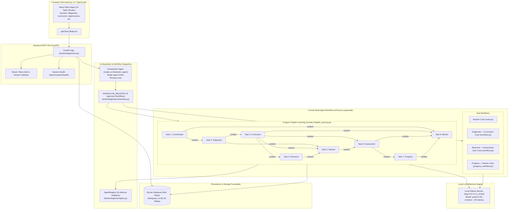
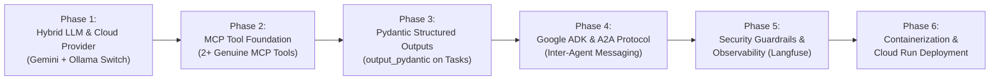

# GYAAN AI — PHASE 0: COMPLETE ARCHITECTURE AUDIT

**Project:** Gyaan AI  
**Audit Date:** November 6, 2026  
**Audited Location:** `D:\Gyaan AI`  
**Protected Legacy Location (Untouched):** `D:\GYAN Ai`  
**Audit Mode:** READ-ONLY ARCHITECTURAL INSPECTION & BASELINE AUDIT  

---

## EXECUTIVE SUMMARY

This report establishes the verified, code-level architectural baseline of **Gyaan AI** prior to commencing the mandatory architecture upgrade. Every finding in this document has been verified by inspecting the actual source code, virtual environment packages, database schemas, and existing test suites inside `D:\Gyaan AI`.

### High-Level Architectural Verdict
1. **Core Strengths**: Gyaan AI possesses an operational, genuine 8-agent sequential learning system built on **CrewAI (v1.15.30)**, powered locally by **Ollama (`qwen2.5:3b`)**, exposed via a high-performance **FastAPI** backend with a comprehensive **SQLite** educational database (23 tables, 17 CBSE subjects, 106 chapters), and rendered via a modern **Next.js 14** web application.
2. **Major Gaps Against Advanced Architectural Requirements**:
   - **Google ADK (Agent Development Kit)**: Completely missing. Not installed, configured, or bridged.
   - **Agent-to-Agent (A2A) Protocol**: Completely missing. Inter-agent interaction is currently limited to CrewAI internal task context text-concatenation; no peer-to-peer messaging, agent addressing, or A2A communication protocol exists.
   - **Model Context Protocol (MCP)**: Completely missing. Zero MCP clients, servers, or agent tool integrations exist. All 8 agents execute with `tools=[]`.
   - **Pydantic in Agent Outputs**: Partially implemented. While FastAPI routes and Diagnostic/Curriculum parsers use Pydantic models, CrewAI tasks do not use `output_pydantic`, and 5 out of 8 agents operate entirely on unstructured markdown text.
   - **Security Guardrails**: Partially implemented. Basic input regex/length validation and bcrypt authentication exist, but prompt-injection defense, toxicity detection, and output moderation guardrails are absent.
   - **Observability & Tracing**: Missing. Langfuse and OpenTelemetry packages exist in `.venv` but have zero code integration; agents lack execution callbacks and distributed tracing.
   - **Cloud Deployment**: Missing. No Dockerfile, Cloud Run configuration, or Firebase configuration exists; backend is tightly coupled to local filesystem paths and local Ollama.

---

## 1. CURRENT ARCHITECTURE DIAGRAM



---

## 2. ACTUAL PROJECT FOLDER STRUCTURE

```
D:\Gyaan AI\
├── .env.example                       # Environment template (Ollama, JWT, DB settings)
├── .gitignore                          # Standard git ignore rules
├── .pytest_cache/                      # Pytest execution cache
├── .venv/                              # Python 3.11 virtual environment (isolated)
├── agents/                             # Root shim package re-exporting backend.agents
│   └── __init__.py
├── orchestration/                      # Root shim package re-exporting orchestrator & registry
│   ├── __init__.py
│   ├── dispatcher.py
│   └── registry.py
├── workflows/                          # Root shim package re-exporting chapter_journey
│   ├── __init__.py
│   └── chapter_learning_journey.py
├── tasks/                              # Empty directory (shim)
│   └── __init__.py
├── tools/                              # Contains legacy pycache only; no active tool source files
│   └── __pycache__/
├── data/                               # Database storage directory
│   ├── gyaan_ai.db                    # Active SQLite database (WAL mode enabled)
│   └── gyaan_ai_backup_*.db           # Historical safety backups
├── backend/                            # Canonical backend implementation
│   ├── __init__.py                    # sys.path bootstrapping and UTF-8 enforcement
│   ├── agents/                        # All 8 canonical CrewAI agents and crew builders
│   │   ├── __init__.py
│   │   ├── orchestrator.py            # Agent 1 + Router + WORKFLOW_REGISTRY (915 lines)
│   │   ├── diagnostic.py              # Agent 2 + Diagnostic Evaluator + Parsers (398 lines)
│   │   ├── curriculum.py              # Agent 3 + Learning Roadmap Designer (353 lines)
│   │   ├── resource.py                # Agent 4 + NCERT Resource Curator (113 lines)
│   │   ├── teacher.py                 # Agent 5 + Concept Tutoring + LLM Factory (46 lines)
│   │   ├── assessment.py              # Agent 6 + Quiz Generator + Grader (192 lines)
│   │   ├── progress.py                # Agent 7 + History & Mastery Analyst (141 lines)
│   │   ├── mentor.py                  # Agent 8 + Actionable Coaching Mentor (134 lines)
│   │   ├── crew.py                    # Standalone Teacher Crew builder (128 lines)
│   │   ├── workflow.py                # Multi-agent workflows (Phase 3 & 4) (348 lines)
│   │   ├── progress_workflow.py       # Progress & Mentor crew workflows (209 lines)
│   │   ├── chapter_journey.py         # Full 8-Agent Chapter Journey & Loop (740 lines)
│   │   └── registry.py                # Central in-memory Agent Registry (426 lines)
│   ├── app/                           # FastAPI web application layer
│   │   ├── __init__.py
│   │   ├── main.py                    # REST API endpoints, routing, error handling (2,172 lines)
│   │   └── schemas.py                 # Pydantic v2 data models & validation (1,012 lines)
│   ├── curriculum/                    # Prescribed curriculum datasets
│   │   └── cbse_class10_data.py       # Official CBSE Class 10 subjects, chapters, topics (1,390 lines)
│   ├── db/                            # SQLite persistence foundation
│   │   ├── __init__.py
│   │   └── database.py                # Schema DDL, migrations, transactional queries (2,550 lines)
│   └── services/                      # Modular application services
│       ├── __init__.py
│       ├── auth_service.py            # Password hashing, JWT/token verification
│       ├── progress_analyzer.py       # Deterministic statistics calculation
│       └── resource_retriever.py      # Local textbook and syllabus text retriever
├── frontend/                           # Next.js 14 React client application
│   ├── package.json                   # Next.js 14.2.35, React 18, Tailwind CSS, Lucide
│   ├── tsconfig.json                  # TypeScript strict configuration
│   ├── app/                           # Next.js App Router (16 static routes)
│   │   ├── layout.tsx                 # Root layout with Inter font and CSS imports
│   │   ├── page.tsx                   # Main dashboard / landing page
│   │   ├── agent-arena/page.tsx       # Multi-agent telemetry, prompt, and execution arena
│   │   ├── curriculum/page.tsx        # CBSE Class 10 interactive curriculum explorer
│   │   ├── diagnostic/page.tsx        # Diagnostic assessment submission & learning plan UI
│   │   ├── learning-plans/page.tsx    # Saved curriculum roadmap viewer
│   │   ├── login/page.tsx & register/ # Student authentication UI
│   │   ├── mentor/page.tsx            # Academic coaching & next milestone viewer
│   │   ├── practice/page.tsx          # Formative quiz generation & answer evaluation UI
│   │   ├── profile/page.tsx           # Student grade and subject settings
│   │   ├── progress/page.tsx          # Mastery analytics & performance trends
│   │   ├── resources/page.tsx         # NCERT chapter & exercise reference viewer
│   │   └── teacher/page.tsx           # Socratic concept tutoring workspace
│   ├── components/                    # Modular UI component library
│   │   ├── layout/                    # AppShell, Navbar, Sidebar, TopNav
│   │   └── ui/                        # Button, Card, Badge, Modal, Input, Alert
│   ├── lib/                           # Frontend API clients & utilities
│   │   ├── api.ts                     # Axios/Fetch client connecting to FastAPI backend
│   │   └── utils.ts
│   └── types/                         # TypeScript interfaces mirroring backend schemas
│       └── index.ts
├── tests/                             # Automated test suite (114 passing pytest tests)
│   ├── conftest.py                    # Windows UTF-8 stream reconfigurator
│   ├── test_agent_arena_registry.py   # Registry discovery & agent factory tests (10 tests)
│   ├── test_api_integration.py        # Live Ollama tutoring integration tests
│   ├── test_api_unit.py               # Mocked API endpoint & schema validation tests (26 tests)
│   ├── test_auth_and_persistence.py   # Session auth & SQLite security tests
│   ├── test_chapter_journey_unit.py   # 8-agent journey DAG & CRUD unit tests (3 tests)
│   ├── test_crewai_encoding.py        # Windows charmap / UTF-8 safety tests
│   ├── test_curriculum_system.py      # CBSE catalog hierarchy & search tests (16 tests)
│   ├── test_database.py               # SQLite schema, foreign keys, and CRUD tests (23 tests)
│   ├── test_diagnostic_curriculum_quality.py # Pedagogical reasoning quality tests
│   ├── test_honest_system_health.py   # 11-tier honest health check tests (4 tests)
│   ├── test_orchestrator_unit.py      # Router, dispatcher, clarification tests
│   ├── test_phase4_integration.py     # Live Resource & Assessment quiz tests
│   ├── test_phase6_integration.py     # Live Progress & Mentoring tests
│   ├── test_phase7_integration.py     # Live Orchestration pipeline tests
│   ├── test_progress_mentor_unit.py   # Mocked Progress-Mentor tests
│   ├── test_teacher_crew.py           # Teacher Agent execution tests
│   └── test_workflow_integration.py   # Diagnostic -> Curriculum live tests
├── pytest.ini                         # Pytest configuration and markers
├── requirements.txt                   # Frozen backend Python dependencies
├── sitecustomize.py                   # Global UTF-8 encoding initialization
└── start_all.bat, start_backend.bat, start_frontend.bat # Local Windows startup scripts
```

---

## 3. EXACT CODE LOCATIONS

| Component / Functionality | File Path | Class / Function Name | Status |
|---|---|---|---|
| **FastAPI Entry Point** | `backend/app/main.py` | `app = FastAPI(...)` (Line 160) | `IMPLEMENTED AND VERIFIED` |
| **System Health Check** | `backend/app/main.py` | `system_health_audit()` (Lines 354–550) | `IMPLEMENTED AND VERIFIED` |
| **Agent Registry Singleton** | `backend/agents/registry.py` | `AgentRegistry`, `agent_registry` (Lines 185–420) | `IMPLEMENTED AND VERIFIED` |
| **Agent 1: Orchestrator** | `backend/agents/orchestrator.py` | `create_orchestrator_agent()` (Lines 62–95) | `IMPLEMENTED AND VERIFIED` |
| **Agent 2: Diagnostic** | `backend/agents/diagnostic.py` | `create_diagnostic_agent()` (Lines 31–66) | `IMPLEMENTED AND VERIFIED` |
| **Agent 3: Curriculum** | `backend/agents/curriculum.py` | `create_curriculum_agent()` (Lines 35–75) | `IMPLEMENTED AND VERIFIED` |
| **Agent 4: Resource** | `backend/agents/resource.py` | `create_resource_agent()` (Lines 12–41) | `IMPLEMENTED AND VERIFIED` |
| **Agent 5: Teacher** | `backend/agents/teacher.py` | `create_teacher_agent()` (Lines 23–46) | `IMPLEMENTED AND VERIFIED` |
| **Agent 6: Assessment** | `backend/agents/assessment.py` | `create_assessment_agent()` (Lines 12–40) | `IMPLEMENTED AND VERIFIED` |
| **Agent 7: Progress** | `backend/agents/progress.py` | `create_progress_agent()` (Lines 23–53) | `IMPLEMENTED AND VERIFIED` |
| **Agent 8: Mentor** | `backend/agents/mentor.py` | `create_mentor_agent()` (Lines 23–54) | `IMPLEMENTED AND VERIFIED` |
| **Full 8-Agent Journey Crew**| `backend/agents/chapter_journey.py`| `build_chapter_learning_journey_crew()` (Lines 405–555) | `IMPLEMENTED AND VERIFIED` |
| **8-Agent Execution Controller**| `backend/agents/chapter_journey.py`| `run_chapter_learning_journey()` (Lines 558–740) | `IMPLEMENTED AND VERIFIED` |
| **Workflow Dispatcher** | `backend/agents/orchestrator.py` | `execute_orchestrated_pipeline()` (Lines 839–915) | `IMPLEMENTED AND VERIFIED` |
| **Approved Workflows Map** | `backend/agents/orchestrator.py` | `WORKFLOW_REGISTRY` (Lines 216–225, 620–750) | `IMPLEMENTED AND VERIFIED` |
| **Teacher Crew Builder** | `backend/agents/crew.py` | `build_teacher_crew()` (Lines 82–128) | `IMPLEMENTED AND VERIFIED` |
| **Diagnostic-Curriculum Crew**| `backend/agents/workflow.py` | `run_learning_plan_workflow()` (Lines 55–146) | `IMPLEMENTED AND VERIFIED` |
| **Progress-Mentor Crew** | `backend/agents/progress_workflow.py`| `build_progress_mentor_crew()` (Lines 46–105) | `IMPLEMENTED AND VERIFIED` |
| **SQLite Connection & Schema**| `backend/db/database.py` | `get_db_connection()`, `init_db()` (Lines 29–380) | `IMPLEMENTED AND VERIFIED` |
| **Curriculum Catalog Seed** | `backend/curriculum/cbse_class10_data.py` | `seed_cbse_class10_curriculum()` (Lines 1230–1390) | `IMPLEMENTED AND VERIFIED` |
| **Authentication & Hash** | `backend/services/auth_service.py`| `hash_password()`, `verify_password()` | `IMPLEMENTED AND VERIFIED` |
| **Pydantic API Schemas** | `backend/app/schemas.py` | 65 `BaseModel` schemas (1,012 lines) | `IMPLEMENTED AND VERIFIED` |
| **Google ADK Integration** | N/A (Does not exist) | None | `MISSING` |
| **A2A Protocol Layer** | N/A (Does not exist) | None | `MISSING` |
| **MCP Client / Servers** | N/A (Does not exist) | None | `MISSING` |
| **Langfuse / Observability**| N/A (Does not exist) | None | `MISSING` |
| **Docker / Cloud Run Config**| N/A (Does not exist) | None | `MISSING` |

---

## 4. AGENT-BY-AGENT AUDIT TABLE

| Agent Name | Source File & Factory Function | CrewAI Agent Implementation | Role, Goal & Backstory Summary | LLM Config & Temp | Assigned Tasks | Registered Tools | Can Execute Standalone? | Executes in Real Workflow? |
|---|---|---|---|---|---|---|:---:|:---:|
| **1. Orchestrator** | `backend/agents/orchestrator.py`<br/>`create_orchestrator_agent()` | `crewai.Agent`<br/>`allow_delegation=False`<br/>`memory=False` | **Role:** Educational AI Workflow Orchestrator.<br/>**Goal:** Interpret educational intent and route requests to approved workflows.<br/>**Backstory:** Experienced educational coordinator familiar with platform agent boundaries. | `model="ollama/qwen2.5:3b"`<br/>`temp=0.1` | • `create_orchestrator_task`<br/>• `create_orchestrator_journey_task` | **None** (`tools=[]`) | **YES**<br/>(via `build_orchestrator_crew`) | **YES**<br/>(in `/api/v1/orchestrate` & `chapter_journey`) |
| **2. Diagnostic** | `backend/agents/diagnostic.py`<br/>`create_diagnostic_agent()` | `crewai.Agent`<br/>`memory=False` | **Role:** Evidence-Based Student Learning Diagnostic Specialist.<br/>**Goal:** Ground evaluation strictly in student evidence; classify into Correct, Partially Correct, Incorrect, Insufficient Evidence.<br/>**Backstory:** Master evaluator adhering to strict evidence rules; never invents unevidenced misconceptions. | `model="ollama/qwen2.5:3b"`<br/>`temp=0.2` | • `create_diagnostic_task`<br/>• `create_diagnostic_journey_task` | **None** (`tools=[]`) | **NO**<br/>(requires downstream curriculum plan or journey) | **YES**<br/>(in `diagnostic_curriculum` & `chapter_journey`) |
| **3. Curriculum** | `backend/agents/curriculum.py`<br/>`create_curriculum_agent()` | `crewai.Agent`<br/>`memory=False` | **Role:** Evidence-Grounded Curriculum Planning Specialist.<br/>**Goal:** Transform diagnostic findings into a prioritized, 3-stage study roadmap with 70% mastery threshold.<br/>**Backstory:** Pedagogical architect who strictly avoids inventing fake textbook page numbers. | `model="ollama/qwen2.5:3b"`<br/>`temp=0.2` | • `create_curriculum_task`<br/>• `create_curriculum_journey_task` | **None** (`tools=[]`) | **NO**<br/>(depends on Diagnostic Task output) | **YES**<br/>(in `diagnostic_curriculum` & `chapter_journey`) |
| **4. Resource** | `backend/agents/resource.py`<br/>`create_resource_agent()` | `crewai.Agent`<br/>`memory=False` | **Role:** Educational Resource Retrieval Specialist.<br/>**Goal:** Review retrieved source excerpts, prioritize NCERT textbook content, report provisional status if unverified.<br/>**Backstory:** Expert curriculum resource curator specializing in CBSE Class 10. | `model="ollama/qwen2.5:3b"`<br/>`temp=0.3` | • `create_resource_task`<br/>• `create_resource_journey_task` | **None** (`tools=[]`) | **YES**<br/>(in `resource_search` workflow) | **YES**<br/>(in `resource_search`, `quiz_generation`, & `chapter_journey`) |
| **5. Teacher** | `backend/agents/teacher.py`<br/>`create_teacher_agent()` | `crewai.Agent`<br/>`memory=False` | **Role:** Class 10 CBSE Science Teacher.<br/>**Goal:** Explain concepts clearly and pedagogically according to NCERT/CBSE standards.<br/>**Backstory:** Dedicated, student-centered Class 10 tutor using accessible everyday analogies. | `model="ollama/qwen2.5:3b"`<br/>`temp=0.3` | • `create_teacher_task`<br/>• `create_teacher_journey_task` | **None** (`tools=[]`) | **YES**<br/>(via `build_teacher_crew` in `/api/v1/ask`) | **YES**<br/>(in `teacher_answer` & `chapter_journey`) |
| **6. Assessment** | `backend/agents/assessment.py`<br/>`create_assessment_agent()` | `crewai.Agent`<br/>`memory=False` | **Role:** Educational Assessment and Feedback Specialist.<br/>**Goal:** Generate balanced diagnostic quizzes (MCQs/short answers) and evaluate submissions objectively against 70% threshold.<br/>**Backstory:** CBSE Class 10 examiner testing conceptual depth over trivia. | `model="ollama/qwen2.5:3b"`<br/>`temp=0.2` | • `create_quiz_generation_task`<br/>• `create_answer_evaluation_task`<br/>• `create_assessment_journey_task` | **None** (`tools=[]`) | **YES**<br/>(in `assessment_evaluation` workflow) | **YES**<br/>(in `quiz_generation`, `assessment_evaluation`, & `chapter_journey`) |
| **7. Progress** | `backend/agents/progress.py`<br/>`create_progress_agent()` | `crewai.Agent`<br/>`allow_delegation=False`<br/>`memory=False` | **Role:** Student Learning Progress Analyst.<br/>**Goal:** Analyze persisted SQLite history to produce evidence-based summaries of trends, strengths, and weaknesses.<br/>**Backstory:** Expert secondary education learning analyst strictly grounded in verified database metrics. | `model="ollama/qwen2.5:3b"`<br/>`temp=0.2` | • `create_progress_analysis_task`<br/>• `create_progress_journey_task` | **None** (`tools=[]`) | **YES**<br/>(in `progress_analysis` workflow) | **YES**<br/>(in `progress_analysis`, `progress_and_mentoring`, & `chapter_journey`) |
| **8. Mentor** | `backend/agents/mentor.py`<br/>`create_mentor_agent()` | `crewai.Agent`<br/>`allow_delegation=False`<br/>`memory=False` | **Role:** Personalized Student Learning Mentor.<br/>**Goal:** Recommend practical next steps and study habits based on actual learning progress and curriculum context.<br/>**Backstory:** Empathetic, disciplined CBSE academic coach prescribing concrete bite-sized interventions. | `model="ollama/qwen2.5:3b"`<br/>`temp=0.3` | • `create_mentor_recommendation_task`<br/>• `create_mentor_journey_task` | **None** (`tools=[]`) | **NO**<br/>(depends on upstream Progress Task output) | **YES**<br/>(in `personalized_mentoring`, `progress_and_mentoring`, & `chapter_journey`) |

---

## 5. CREWAI VERSUS ADK IMPLEMENTATION STATUS

| Feature | CrewAI Implementation Status | Google ADK Implementation Status | Verified Architectural Reality |
|---|:---:|:---:|---|
| **Package Installation** | `IMPLEMENTED AND VERIFIED`<br/>(`crewai==1.15.30` in `.venv`) | `MISSING`<br/>(0 ADK packages in `.venv`) | CrewAI core, tools, and CLI are fully installed. Google ADK / Agent Development Kit is not installed. |
| **Agent Construct** | `IMPLEMENTED AND VERIFIED`<br/>(`from crewai import Agent`) | `MISSING` | All 8 agents instantiate `crewai.Agent`. There are no Google ADK Agent constructs. |
| **Task / Goal Model** | `IMPLEMENTED AND VERIFIED`<br/>(`from crewai import Task`) | `MISSING` | Tasks are pure CrewAI `Task` objects. |
| **Crew Orchestration** | `IMPLEMENTED AND VERIFIED`<br/>(`from crewai import Crew, Process`) | `MISSING` | Crews execute via `crew.kickoff()` using `Process.sequential`. |
| **Ollama Connectivity** | `IMPLEMENTED AND VERIFIED`<br/>(`from crewai import LLM`) | `MISSING` | CrewAI's `LLM` class connects to local Ollama via LiteLLM backend. |
| **A2A Interoperability** | `MISSING` | `MISSING` | Neither framework is bridged to an external Agent-to-Agent protocol. |

**Audit Finding**: The project is 100% CrewAI-based. Google ADK is entirely absent from the codebase and virtual environment.

---

## 6. AGENT-TO-AGENT (A2A) COMMUNICATION STATUS

### Verified Code Analysis
In Gyaan AI, inter-agent data transfer occurs exclusively through **CrewAI Task Context Sharing** and **Python In-Memory Passing**:

1. **CrewAI Task Context (`Task(context=[...])`)**:
   - In `backend/agents/chapter_journey.py` (Lines 433–505), downstream tasks declare upstream tasks in their `context` list:
     - `t2_diagnostic` receives context from `[t1_orchestrator]`
     - `t3_curriculum` receives context from `[t2_diagnostic]`
     - `t4_resource` receives context from `[t3_curriculum]`
     - `t5_teacher` receives context from `[t2_diagnostic, t3_curriculum, t4_resource]`
     - `t6_assessment` receives context from `[t3_curriculum, t5_teacher]`
     - `t7_progress` receives context from `[t6_assessment]`
     - `t8_mentor` receives context from `[t1_orchestrator, t3_curriculum, t6_assessment, t7_progress]`
   - **Mechanism**: When `Process.sequential` executes, CrewAI takes the raw string output (`output.raw`) of each upstream task and injects it as supplementary prompt text into the downstream agent's prompt.
2. **Shared State**:
   - The only shared state across agents is the local SQLite database (`data/gyaan_ai.db`) and the in-memory singleton `AgentRegistry` (`backend/agents/registry.py`).
3. **Absence of Genuine A2A Protocol**:
   - **No Agent Addressing / ID Routing**: Agents cannot address messages to peer agents.
   - **No Asynchronous Message Bus**: No AMQP, MQTT, Redis pub/sub, WebSocket, or gRPC communication channel exists between agents.
   - **No Dynamic Peer Discovery**: An agent cannot query a directory service to locate an agent capable of a specific capability.
   - **No A2A Handshake / Negotiation**: All workflows are hardcoded in linear Python DAGs.

**Status**: `MISSING`. CrewAI task context injection is functional, but genuine Agent-to-Agent (A2A) protocol is completely unimplemented.

---

## 7. PYDANTIC IMPLEMENTATION STATUS

| Layer / Agent | Pydantic Models Used | Location in Code | Status | Exact Usage Details |
|---|---|---|:---:|---|
| **FastAPI REST Layer** | 65 Pydantic Models | `backend/app/schemas.py` | `IMPLEMENTED AND VERIFIED` | Request validation and response serialization across all endpoints in `backend/app/main.py`. |
| **Diagnostic Agent** | `DiagnosticReportModel`<br/>`QuestionDiagnosis`<br/>`AnswerClassification` | `backend/app/schemas.py`<br/>`backend/agents/diagnostic.py` | `IMPLEMENTED AND VERIFIED` | `parse_diagnostic_report()` parses raw LLM output into `DiagnosticReportModel`, validated via Pydantic v2. |
| **Curriculum Agent** | `CurriculumPlanModel`<br/>`LearningStage` | `backend/app/schemas.py`<br/>`backend/agents/curriculum.py` | `IMPLEMENTED AND VERIFIED` | `parse_curriculum_plan()` parses raw LLM output into `CurriculumPlanModel`, validating stage numbers and objectives. |
| **Orchestrator Agent** | `OrchestrationRequest`<br/>`RoutingDecision`<br/>`OrchestrationResponse` | `backend/app/schemas.py`<br/>`backend/agents/orchestrator.py` | `IMPLEMENTED AND VERIFIED` | Validates routing decisions and dispatches registered workflows. |
| **Teacher Agent** | None | `backend/agents/teacher.py` | `MISSING` | Agent produces raw markdown text; no Pydantic model is used. |
| **Resource Agent** | None | `backend/agents/resource.py` | `MISSING` | Operates on untyped Python dictionaries (`retrieved_data.get(...)`). |
| **Assessment Agent** | None | `backend/agents/assessment.py` | `MISSING` | Quiz generation outputs raw JSON parsed into dicts; grading outputs unstructured text. |
| **Progress Agent** | None | `backend/agents/progress.py` | `MISSING` | Operates on raw dictionary stats; outputs unstructured markdown. |
| **Mentor Agent** | None | `backend/agents/mentor.py` | `MISSING` | Outputs unstructured bullet points; does not validate recommendations against a schema. |
| **CrewAI Task Integration** | `output_pydantic` | All agent tasks | `MISSING` | **Zero** `Task` instances pass `output_pydantic=MyModel`. Parsing is handled downstream via regex/json_repair. |

**Audit Finding**: Pydantic is `PARTIALLY IMPLEMENTED`. It is robust in the web layer and in Diagnostic/Curriculum/Orchestrator output parsing, but absent in 5 agents and completely absent from CrewAI `Task(output_pydantic=...)` definitions.

---

## 8. MCP (MODEL CONTEXT PROTOCOL) & TOOLS STATUS

### Verified Inspection Results
1. **Registered Agent Tools**:
   - Inspected `create_*_agent()` across all 8 agent files.
   - **Count: 0**. Every agent is instantiated without a `tools` parameter (defaults to `tools=[]`).
2. **Custom Tools**:
   - Searched for `@tool`, `from crewai.tools import`, and `BaseTool` across the entire codebase.
   - **Count: 0**. No custom CrewAI tool classes or functions exist.
3. **Directory `tools/`**:
   - Contains only `tools/__pycache__/seed_curriculum_catalog.cpython-311.pyc` (historical artifact). No source `.py` files exist in `tools/`.
4. **Pseudo-Tool Services (Current Workaround)**:
   - Instead of agents invoking tools, Python backend services execute deterministic logic *before* calling the agent, passing the result as string prompt context:
     - `backend/services/resource_retriever.py` (`retrieve_local_resources`) fetches textbook text and passes it into `create_resource_task(..., retrieved_data=...)`.
     - `backend/services/progress_analyzer.py` (`calculate_objective_statistics`) queries SQLite and passes dicts into `create_progress_journey_task(..., objective_stats=...)`.
5. **MCP Clients and Servers**:
   - `mcp` library (v1.30.0) is installed in `.venv`.
   - **Zero** MCP client connections, MCP server implementations, or tool bridges exist in the project.
   - The requirement for at least two genuine MCP tools is completely unfulfilled.

**Status**: `MISSING`.

---

## 9. SECURITY AND OBSERVABILITY STATUS

### Security Audit
| Security Dimension | Implemented Mechanism | Code Location | Status | Evaluation |
|---|---|---|:---:|---|
| **Input Validation** | Pydantic v2 string length, regex, min/max constraints | `backend/app/schemas.py` | `IMPLEMENTED AND VERIFIED` | Strong schema validation on all incoming API payloads. |
| **Authentication** | Bearer session token + bcrypt / PBKDF2 hashing | `backend/services/auth_service.py`<br/>`backend/app/main.py` | `IMPLEMENTED AND VERIFIED` | Valid session tokens, expiration checking, 24h default TTL. |
| **Multi-Student Isolation** | Ownership verification checks on student records | `backend/app/main.py`<br/>Lines 1663, 1716, 1791 | `IMPLEMENTED AND VERIFIED` | Prevents students from querying or modifying other students' journeys. |
| **Prompt Injection Defense** | None | N/A | `MISSING` | Raw student inputs are directly interpolated into agent prompt strings. |
| **Toxicity / Safety Guardrails**| None | N/A | `MISSING` | No Llama Guard, NeMo Guardrails, or content moderation filters. |
| **Output Sanitization** | Basic JSON repair and markdown stripping | `clean_json_payload()` | `PARTIALLY IMPLEMENTED` | Ensures valid JSON parsing, but no semantic safety or hallucination filter. |
| **Tool Access Controls** | N/A | N/A | `MISSING` | No tools exist to restrict. |

### Observability Audit
| Observability Dimension | Implemented Mechanism | Code Location | Status | Evaluation |
|---|---|---|:---:|---|
| **Local Logging** | Python `logging.getLogger("gyaan_ai.*")` | All backend modules | `IMPLEMENTED AND VERIFIED` | Standard console logging. |
| **Agent Execution Telemetry** | `AgentRegistry.track_execution()` context manager | `backend/agents/registry.py`<br/>Lines 220–250 | `IMPLEMENTED AND VERIFIED` | Tracks status (`idle`, `running`, `completed`, `error`), execution counts, latency. |
| **CrewAI Callbacks** | None | N/A | `MISSING` | No `step_callback` or `task_callback` configured in any Crew or Agent. |
| **Distributed Tracing** | None | N/A | `MISSING` | OpenTelemetry is in `.venv` but zero trace instrumentation exists in code. |
| **Langfuse Integration** | None | N/A | `MISSING` | `langfuse` (v4.15.6) is installed in `.venv`, but zero imports or API keys exist in code. |
| **Token & Cost Tracking** | None | N/A | `MISSING` | No prompt token or completion token tracking exists. |

---

## 10. CLOUD DEPLOYMENT READINESS

| Component | Target Architecture | Current State | Readiness Status |
|---|---|---|:---:|
| **Containerization** | Dockerfile / Multi-stage build | No `Dockerfile` or `docker-compose.yml` exists. | `MISSING` |
| **Cloud Run** | Google Cloud Run service | No Cloud Run build triggers or deployment scripts. | `MISSING` |
| **Firebase** | Firebase Auth / Hosting / Firestore | No `firebase.json` or Firebase SDK integration. | `MISSING` |
| **Database Architecture** | Cloud SQL / Spanner / Persistent Store | Local SQLite file (`data/gyaan_ai.db`). Ephemeral on serverless containers. | `MISSING` (Cloud Unready) |
| **LLM Provider Coupling** | Google Cloud Vertex AI / Gemini 1.5/2.0 | Strictly hardcoded to local Ollama (`http://127.0.0.1:11434`). | `MISSING` (Local Lock-In) |
| **Configuration / Secrets** | Google Cloud Secret Manager / Cloud KMS | Plain text `.env.example` template; hardcoded fallback secrets. | `PARTIALLY IMPLEMENTED` |

**Audit Finding**: The system is completely optimized for a single local Windows machine. It cannot be deployed to Google Cloud or Cloud Run without containerization, cloud database migration, and cloud LLM provider configuration.

---

## 11. EXISTING TESTS AND EXECUTION EVIDENCE

### Test Suite Execution Summary
Verified live via pytest: **114 tests collected, 114 passed, 0 failures, 0 errors** in **241.27 seconds**.

| Test File | Total Tests | Mocked vs. Live Inference | Tested Scope |
|---|:---:|:---:|---|
| `tests/test_honest_system_health.py` | 4 | **Live Component Probe** | Verifies 11-tier health endpoint, database counts, Ollama status, and registry. |
| `tests/test_api_unit.py` | 26 | **Mocked Unit** | Tests FastAPI request/response contracts, schema boundaries, and mock crew execution. |
| `tests/test_orchestrator_unit.py` | 9 | **Mocked Unit** | Tests Orchestrator routing decisions, out-of-scope intent, and dispatcher. |
| `tests/test_progress_mentor_unit.py` | 5 | **Mocked Unit** | Tests Progress and Mentor workflow crew execution with mocked LLM output. |
| `tests/test_chapter_journey_unit.py` | 3 | **Mocked Unit / Live DB** | Verifies 8-agent task DAG dependencies, registry registration, and SQLite journey CRUD. |
| `tests/test_agent_arena_registry.py` | 10 | **Live Factory Inspection** | Verifies all 8 agent factory instantiations, metadata extraction, and telemetry. |
| `tests/test_database.py` | 23 | **Live SQLite Integration** | Tests transactional integrity, migrations, foreign keys, and multi-student data. |
| `tests/test_curriculum_system.py` | 16 | **Live SQLite Integration** | Tests CBSE Class 10 catalog hierarchy, unit/chapter/topic queries, and search. |
| `tests/test_auth_and_persistence.py`| 11 | **Live DB / Service** | Tests password hashing, session expiration, token hashes, and student profiles. |
| `tests/test_crewai_encoding.py` | 7 | **Live Process** | Tests Windows UTF-8 stdout streams and prevents `charmap` codec exceptions. |
| `tests/test_api_integration.py` | 1 | **Live Ollama Inference** | Executes live query against local `qwen2.5:3b` via `/api/v1/ask`. |
| `tests/test_phase4_integration.py` | 2 | **Live Ollama Inference** | Executes live Resource Agent retrieval and Quiz Generation against Ollama. |
| `tests/test_phase6_integration.py` | 2 | **Live Ollama Inference** | Executes live Progress Analysis and Mentoring recommendation against Ollama. |
| `tests/test_phase7_integration.py` | 3 | **Live Ollama Inference** | Executes live Orchestrator routing and intent classification against Ollama. |
| `tests/test_workflow_integration.py`| 1 | **Live Ollama Inference** | Executes live Diagnostic -> Curriculum sequential crew against Ollama. |
| `tests/test_teacher_crew.py` | 1 | **Live Ollama Inference** | Executes live Teacher concept explanation against Ollama. |

### Live End-to-End 8-Agent Execution Evidence
- **Evidence File**: `D:\Gyaan AI\chapter_journey_live_execution_evidence.json`
- **Execution Script**: `scratch/verify_live_eight_agent_journey.py`
- **Execution Duration**: **43.68 seconds**
- **Verified Outcomes**:
  - All 8 canonical agents executed in exact sequence.
  - Formative assessment score: **2/2 (100%)**, Status: `SATISFIED`.
  - Mastery score: **75.0%**, Adaptive Action: `advance_to_next_topic`.
  - Persisted in SQLite `learning_journeys` table (Journey ID: `jrn_ee21a939b2d2`).

---

## 12. MISSING REQUIREMENTS (GAP ANALYSIS)

The following components are required for the target architecture but currently **MISSING**:

1. **Google ADK (Agent Development Kit)**:
   - Zero ADK library dependencies installed.
   - Zero ADK agent abstractions implemented.
2. **Agent-to-Agent (A2A) Protocol**:
   - No standardized inter-agent message protocol.
   - No peer discovery, agent capability advertisement, or inter-agent messaging bus.
3. **Model Context Protocol (MCP)**:
   - No MCP client or server infrastructure.
   - Zero executable tools attached to any of the 8 agents.
   - Need at least two functional MCP tools (e.g., NCERT Syllabus Search Tool and SQLite Mastery Query Tool).
4. **Pydantic Task Enforcement**:
   - `output_pydantic` missing from all CrewAI tasks.
   - Teacher, Resource, Assessment, Progress, and Mentor agents output raw text rather than typed schemas.
5. **AI Safety & Guardrails**:
   - No prompt-injection detection layer.
   - No content moderation or toxicity filters.
   - No automated hallucination verification guardrail.
6. **Observability & Tracing**:
   - Langfuse is installed in `.venv` but not initialized or hooked into CrewAI.
   - No OpenTelemetry tracing or token/cost analytics.
   - No CrewAI step/task callbacks.
7. **Cloud Infrastructure & Hybrid LLM**:
   - No Docker containerization.
   - No Google Cloud Run deployment configuration.
   - Hardcoded local Ollama dependency with no switch for Google Cloud Vertex AI / Gemini 1.5/2.0.
   - Database is local SQLite; unready for stateless cloud environments.

---

## 13. TECHNICAL RISKS

1. **Local Model Reasoning Fragility (`qwen2.5:3b`)**:
   - A 3-billion parameter model has limited context window (~4K tokens) and occasional JSON schema drift. Chaining 8 tasks via string context risks context truncation or formatting failure if inputs grow large.
2. **Stateless Cloud Run vs. Local SQLite Concurrency**:
   - SQLite cannot be shared across multiple horizontal instances in Cloud Run. Deploying to Cloud Run without migrating to Cloud SQL (PostgreSQL) or mounting a persistent network volume will result in immediate data divergence and loss.
3. **Prompt Injection & Unsanitized Student Inputs**:
   - Student queries are directly interpolated into agent prompt strings (e.g. `f"Student Request: {user_request}"`). A student submitting malicious prompt overrides could force agents to hallucinate, bypass Class 10 scope, or output inappropriate content.
4. **Toolless Agent Hallucination Risk**:
   - Because Resource and Curriculum agents lack real-time query tools, they rely on pre-fetched static text passed into prompts. When pre-fetched text is absent, the LLM is at risk of inventing textbook exercises or chapter sections.

---

## 14. RECOMMENDED IMPLEMENTATION SEQUENCE (PHASE 1 ONWARD)

To systematically address all audit findings while preserving the verified working system, the following phased sequence is recommended:



### Phase Details

#### Phase 1: Dual LLM Engine & Cloud Provider Abstraction
- Implement provider abstraction supporting both **Local Ollama (`qwen2.5:3b`)** and **Google Cloud Gemini (`gemini-1.5-flash` / `gemini-2.0-flash`)**.
- Keep local Ollama as default fallback; enable cloud Gemini via environment variable (`LLM_PROVIDER=gemini` or `LLM_PROVIDER=ollama`).
- **Safety**: Does not break existing local workflows.

#### Phase 2: Genuine MCP Tool Integration (Minimum 2 Tools)
- Implement genuine Model Context Protocol (MCP) tool integration for agents.
- **Tool 1**: `NCERTTextbookSearchTool` — semantic/keyword search over official Class 10 syllabus and chapters.
- **Tool 2**: `StudentMasteryDBTool` — structured tool querying SQLite for student past performance and mastery metrics.
- Assign tools to Resource, Assessment, and Progress agents.

#### Phase 3: Complete Pydantic Output Enforcement
- Implement Pydantic output schemas across all 8 agents.
- Configure `output_pydantic=...` directly on CrewAI `Task` definitions.
- Eliminate fragile regex and manual markdown string parsing in downstream workflows.

#### Phase 4: Google ADK & A2A Communication Layer
- Install and configure Google ADK.
- Create ADK agent wrappers for the 8 canonical agents.
- Implement an explicit Agent-to-Agent (A2A) communication protocol enabling direct structured messaging and peer discovery between agents.

#### Phase 5: Security Guardrails & Observability (Langfuse)
- Integrate Langfuse tracing into all CrewAI workflows via CrewAI callbacks (`step_callback`, `task_callback`).
- Add prompt-injection detection and toxicity guardrails on student input endpoints.
- Track token consumption, latency, and agent reasoning traces.

#### Phase 6: Cloud Deployment & Containerization
- Author multi-stage `Dockerfile` for backend (FastAPI) and frontend (Next.js).
- Configure Google Cloud Run build specifications and environment variable management.
- Provide database migration path (SQLite $\to$ PostgreSQL / Cloud SQL) for stateless cloud execution.

---

## AUDIT SIGN-OFF & VERDICT

- **Architecture Status**: Verified local CrewAI multi-agent platform operational.
- **Upgrade Readiness**: Baseline documented; architectural gaps clearly delineated.
- **Action Required**: Wait for user review and approval before beginning Phase 1.
