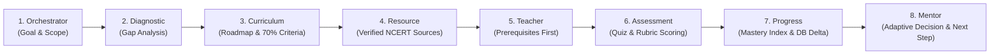

# Gyaan AI — Multi-Agent Personalized Learning System

Gyaan AI is a genuine, locally runnable, CrewAI-based Multi-Agent Personalized Learning System tailored for CBSE Class 6–12 secondary education. Powered by local Ollama GPU inference with zero external cloud API dependencies, Gyaan AI implements a sequential learning architecture where eight canonical AI agents collaborate to guide students from diagnostic assessment through curriculum planning, NCERT resource curation, Socratic concept tutoring, formative testing, progress analytics, and adaptive mentoring.

---

## 1. Project Architecture

The architecture consists of a decoupled frontend, backend, and local LLM runtime:

```
+---------------------------------------------------------------------------------+
|                                 Next.js 14 Frontend                             |
|  - App Router (React 18 + Tailwind CSS)                                         |
|  - Ports: http://localhost:3000                                                 |
|  - Routes: / (Overview), /teacher, /diagnostic, /learning-plans, /resources,    |
|            /practice, /progress, /mentor, /agent-arena                          |
+---------------------------------------------------------------------------------+
                                       |
                                       | HTTP / REST (apiClient)
                                       v
+---------------------------------------------------------------------------------+
|                                 FastAPI Backend                                 |
|  - Host: http://127.0.0.1:8000                                                  |
|  - Endpoints: /health, /api/v1/ask, /api/v1/learning-plan, /api/v1/resources,  |
|               /api/v1/quizzes, /api/v1/assessments/submit, /api/v1/orchestrate, |
|               /api/v1/learning-journey/*, /api/v1/students/me/*                 |
+---------------------------------------------------------------------------------+
                                       |
           +---------------------------+---------------------------+
           |                                                       |
           v                                                       v
+---------------------------------------+   +---------------------------------------+
|          Eight CrewAI Agents          |   |            SQLite Database            |
|  - Genuine Agent, Task, Crew          |   |  - Path: data/gyaan_ai.db             |
|  - Chained Context Dependencies       |   |  - WAL mode + Foreign Key enforcement |
|  - Process.sequential Execution       |   |  - Relational Multi-Tenant Isolation  |
+---------------------------------------+   +---------------------------------------+
                   |
                   v
+---------------------------------------------------------------------------------+
|                         Local Ollama LLM Runtime                                |
|  - Endpoint: http://127.0.0.1:11434/v1                                          |
|  - Model: qwen2.5:3b (GPU Accelerated)                                          |
|  - 100% Sovereign Local Inference — Zero Cloud APIs                             |
+---------------------------------------------------------------------------------+
```

---

## 2. Eight Canonical CrewAI Agents

Each agent is a genuine `crewai.Agent` instance with distinct pedagogical roles, goals, and backstories:

1. **Orchestrator Agent** (`Educational AI Workflow Orchestrator`):
   Interprets student intent, structures learning goals, enforces RBAC and tenant boundaries, and initiates multi-agent workflows from `WORKFLOW_REGISTRY`.
2. **Diagnostic Agent** (`Student Learning Diagnostic Specialist`):
   Evaluates student baseline knowledge, analyzes actual answers, identifies missing prerequisites, and uncovers conceptual misconceptions without fabricating scores.
3. **Curriculum Agent** (`Personalized Curriculum Planning Specialist`):
   Transforms diagnostic reports into prioritized 3-stage study roadmaps (Stage 1: Foundational Recovery $\rightarrow$ Stage 2: Core Concepts $\rightarrow$ Stage 3: Applied Verification) with a mandatory 70% mastery threshold.
4. **Resource Agent** (`Educational Resource Retrieval Specialist`):
   Curates verified NCERT textbook chapters, official citations, section references, and illustrative exercises. Never fabricates citations or URLs.
5. **Teacher Agent** (`Class 10 CBSE Science Teacher`):
   Teaches missing prerequisites first, explains core chapter principles step-by-step using real-world analogies, and poses comprehension checkpoint questions.
6. **Assessment Agent** (`Educational Assessment and Feedback Specialist`):
   Generates balanced diagnostic quizzes (MCQs and conceptual short answers) and evaluates student submissions with objective scoring and constructive feedback.
7. **Progress Agent** (`Student Learning Progress Analyst`):
   Analyzes actual historical assessment data from SQLite, calculates rolling topic mastery indices, and determines empirical performance trends.
8. **Mentor Agent** (`Personalized Student Learning Mentor`):
   Synthesizes journey findings to provide adaptive recommendations (Advance vs. Remediate), actionable study habit coaching, and concrete milestone targets.

---

## 3. Complete Sequential Learning Journey (`chapter_learning_journey`)

The primary workflow is `chapter_learning_journey`, executed with `Process.sequential`:



### Context Chaining Architecture
In `chapter_learning_journey`, each task receives relevant context and output from upstream tasks:
- **Task 2 (Diagnostic)** receives context from `[task1_orchestrator]`.
- **Task 3 (Curriculum)** receives context from `[task2_diagnostic]`.
- **Task 4 (Resource)** receives context from `[task3_curriculum]`.
- **Task 5 (Teacher)** receives context from `[task2_diagnostic, task3_curriculum, task4_resource]`.
- **Task 6 (Assessment)** receives context from `[task3_curriculum, task5_teacher]`.
- **Task 7 (Progress)** receives context from `[task6_assessment]`.
- **Task 8 (Mentor)** receives context from `[task1_orchestrator, task3_curriculum, task6_assessment, task7_progress]`.

---

## 4. Adaptive Learning Loop

Learning is not treated as a blind, one-pass process:
- **Mastery Criteria Satisfied ($\ge 70\%$)**:
  Topic is marked as mastered in SQLite (`student_topic_mastery`). The student is awarded completion credit and guided by the Mentor Agent to advance to the next milestone.
- **Mastery Criteria Not Satisfied ($< 70\%$)**:
  The system identifies specific remaining knowledge gaps and loops back to targeted Teacher remediation, retrieves supplementary NCERT resources, generates a fresh formative quiz, and recalculates mastery.
- **Safety Safeguards**:
  - Configurable maximum retry limit (default: 3 iterations) prevents runaway loops.
  - Students can pause, resume, or exit the journey at any point.
  - All intermediate states persist in SQLite (`learning_journeys`).

---

## 5. Directory Structure & VS Code Organization

The workspace is organized to expose all architectural components in the VS Code Explorer:

```
D:\Gyaan AI\
├── agents/             # Canonical exports for all 8 CrewAI agents & local LLM
├── tasks/              # Canonical CrewAI Task factory definitions with context passing
├── workflows/          # Sequential Crews (chapter_learning_journey, tutoring, etc.)
├── orchestration/      # Central WORKFLOW_REGISTRY and intent dispatcher
├── database/           # SQLite connection, tables, and CRUD persistence
├── backend/            # FastAPI REST backend and application services
│   ├── app/            # main.py, schemas.py
│   ├── db/             # database.py
│   └── services/       # auth_service.py, progress_analyzer.py, resource_retriever.py
├── frontend/           # Next.js 14 application shell and interactive pages
├── tests/              # Automated unit and integration test suite (pytest)
├── data/               # SQLite database file (gyaan_ai.db) and automated backups
├── .venv/              # Dedicated Python 3.11 virtual environment
├── .vscode/            # Workspace settings (configured Python interpreter)
├── .env.example        # Reference environment variables template
├── requirements.txt    # Documented Python dependencies
├── start_all.bat       # Master one-click startup script
├── start_backend.bat   # Dedicated FastAPI backend launcher
├── start_frontend.bat  # Dedicated Next.js frontend launcher
└── README.md           # Master system documentation
```

---

## 6. Local Ollama LLM Setup

1. Install [Ollama for Windows](https://ollama.ai).
2. Download the canonical Class 10 reasoning model:
   ```bash
   ollama pull qwen2.5:3b
   ```
3. Start the Ollama server:
   ```bash
   ollama serve
   ```
4. Verify local model availability at `http://127.0.0.1:11434/api/tags`.

---

## 7. Python Virtual Environment Activation

The project uses Python 3.11 located in `D:\Gyaan AI\.venv`:

```powershell
# PowerShell
& "D:\Gyaan AI\.venv\Scripts\Activate.ps1"

# Command Prompt (cmd)
"D:\Gyaan AI\.venv\Scripts\activate.bat"
```

In VS Code, select the interpreter:
`D:\Gyaan AI\.venv\Scripts\python.exe`

---

## 8. Starting the Application

### Option A: One-Click Master Startup (Recommended)
Double-click or run:
```bat
D:\Gyaan AI\start_all.bat
```
This script checks Ollama on port 11434, spawns the FastAPI backend, polls `/health` until healthy, launches the Next.js dev server on port 3000, and opens your browser.

### Option B: Individual Service Launchers
1. **FastAPI Backend**:
   ```bat
   D:\Gyaan AI\start_backend.bat
   ```
   (Runs on `http://127.0.0.1:8000`, interactive API docs at `http://127.0.0.1:8000/docs`)
2. **Next.js Frontend**:
   ```bat
   D:\Gyaan AI\start_frontend.bat
   ```
   (Runs on `http://localhost:3000`)

---

## 9. Environment Configuration

Copy `.env.example` to `.env` or `frontend/.env.local` to customize ports and parameters:

```ini
OLLAMA_BASE_URL=http://127.0.0.1:11434/v1
OLLAMA_MODEL=qwen2.5:3b
BACKEND_HOST=127.0.0.1
BACKEND_PORT=8000
FRONTEND_PORT=3000
DATABASE_PATH=data/gyaan_ai.db
```

---

## 10. Testing Instructions

### Run Automated Unit Regression Suite
```powershell
& "D:\Gyaan AI\.venv\Scripts\python.exe" -m pytest -v -m "not integration"
```

### Run Frontend TypeScript Compilation Check
```cmd
cd /d D:\Gyaan AI\frontend && npx tsc --noEmit
```

### Run Complete End-to-End Master Journey Verification
```powershell
& "D:\Gyaan AI\.venv\Scripts\python.exe" "D:\Gyaan AI\verify_final_master_audit.py"
```

---

## 11. Protected Repository Notice

The legacy repository located at `D:\GYAN Ai` is strictly protected, isolated, and unmodified. All active development and data persistence reside exclusively in `D:\Gyaan AI`.
