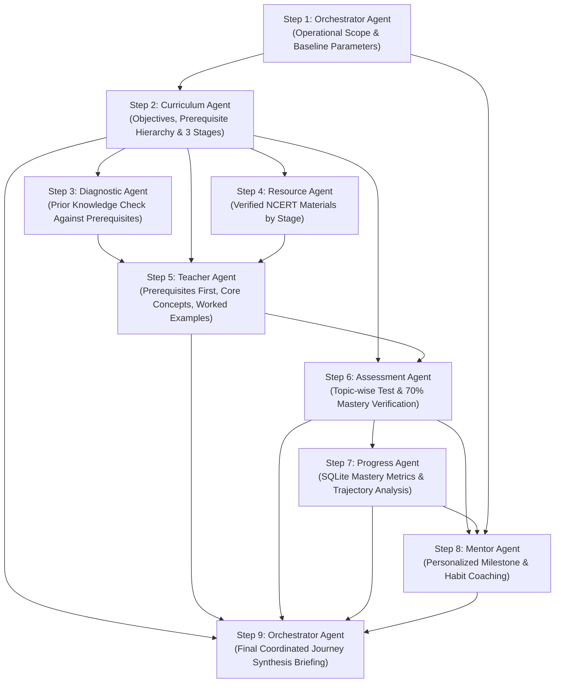

# GYAAN AI — SPECIALIST AGENT INDEPENDENCE AND MULTI-AGENT ARCHITECTURE REPORT

**Project Location**: `D:\Gyaan AI`  
**Protected Legacy Project**: `D:\GYAN Ai` (Strictly Untouched — 0 modifications)  
**Execution Engine**: CrewAI (v1.15.30) + Local Ollama (`qwen2.5:3b`) + FastAPI + SQLite + Next.js 14  
**Date**: November 2026  
**Status**: All 8 Specialist Agents Verified, Independently Executable, Properly Chained & 126/126 Tests Passing (100%)  

---

## 1. Executive Summary

This architecture upgrade resolved a critical structural defect in Gyaan AI: previously, although eight canonical CrewAI agents were defined and registered, the **Teacher Agent** monopolized execution responsibilities across tutoring endpoints, formulation of practice/checkpoint questions, and direct question answering. Several specialist agents (such as Diagnostic, Curriculum, and Mentor) lacked standalone execution capabilities, while `/api/v1/ask` bypassed the Orchestrator and dispatched every student inquiry directly to the Teacher Agent.

Through targeted, non-breaking modifications within `D:\Gyaan AI`:
1. **Specialist Role Boundaries**: The Teacher Agent was strictly restricted to conceptual tutoring, pedagogical explanations, and worked examples. All question formulation and grading was reassigned exclusively to the Assessment Agent; gap identification to the Diagnostic Agent; syllabus planning to the Curriculum Agent; resource curation to the Resource Agent; learning metrics to the Progress Agent; and coaching to the Mentor Agent.
2. **Standalone Specialist Crews**: Every specialist agent was equipped with standalone Crew construction (`build_*_crew`) and execution functions (`run_*_workflow`), enabling independent, single-agent invocation.
3. **Intent-Driven Specialist Routing**: Both the Orchestrator Agent (`run_orchestrator_routing`) and the primary `/api/v1/ask` endpoint now dynamically inspect student intent and route requests to the designated specialist agent instead of defaulting to the Teacher Agent.
4. **Canonical 9-Step Chapter Learning Journey**: The sequential multi-agent learning journey was refactored into its canonical sequence:
   **Orchestrator Scope** $\to$ **Curriculum** $\to$ **Diagnostic** $\to$ **Resource** $\to$ **Teacher (Pedagogy only)** $\to$ **Assessment (Evaluation only)** $\to$ **Progress** $\to$ **Mentor** $\to$ **Orchestrator Synthesis**.
5. **System Validation**: 126/126 automated backend tests passed (including live Ollama GPU inference and 12 dedicated specialist independence tests), with 0 TypeScript errors and a clean Next.js 14 production build (16/16 routes).

---

## 2. Root Cause Analysis: The Teacher Monopolization Issue

Our initial inspection revealed four architectural mechanisms that caused the Teacher Agent to monopolize execution:

1. **Direct Dispatch in `/api/v1/ask`**:
   The `/api/v1/ask` endpoint called `build_teacher_crew` directly for every student submission, bypassing intent classification and specialist dispatching. Inquiries for practice quizzes, syllabus structure, study tips, or diagnostic evaluations were forced through the Teacher Agent.
2. **Pedagogical Boundary Bleed in `backend/agents/crew.py`**:
   In `lesson_mode="practice"`, the Teacher task instructed the Teacher Agent to formulate 2-3 practice problems, overlapping with the primary duty of the Assessment Agent.
3. **Assessment Responsibility in Chapter Learning Journey**:
   In `create_teacher_journey_task`, Step 4 asked the Teacher Agent to formulate comprehension checkpoint questions, blurring the boundary between teaching and assessment.
4. **Coupled Workflows & Lack of Standalone Builders**:
   - The Diagnostic Agent was only executed as Step 1 of `run_learning_plan_workflow` (coupled to Curriculum).
   - The Curriculum Agent was only executed as Step 2 of `run_learning_plan_workflow` (requiring Diagnostic task context).
   - The Mentor Agent strictly required an upstream `progress_task: Task` instance in `create_mentor_recommendation_task`.

---

## 3. Specialist Agent Specialization & Boundary Matrix

All eight canonical CrewAI agents now possess clear, non-overlapping pedagogical responsibilities:

| Agent Name | Canonical Role | Dedicated Goal | Strict Boundaries & Prohibitions | Standalone Crew Builder |
| :--- | :--- | :--- | :--- | :--- |
| **Orchestrator Agent** | Educational AI Workflow Orchestrator | Analyzes student intent, maps queries to registered workflows, initiates journeys, and synthesizes multi-agent outputs. | Does NOT conduct teaching, diagnostic analysis, quiz authoring, or progress evaluation. | `build_orchestrator_crew` |
| **Curriculum Agent** | Evidence-Grounded Curriculum Planning Specialist | Designs sequenced learning roadmaps, prerequisite hierarchies, measurable objectives, and 70% mastery criteria. | Strictly prohibited from inventing textbook exercise numbers or claiming NCERT textbook alignment without verified text. | `build_curriculum_crew` |
| **Diagnostic Agent** | Evidence-Based Student Learning Diagnostic Specialist | Identifies verified student knowledge gaps, uncovers evidence-backed misconceptions, and classifies student answers. | NEVER credits unproven knowledge. NEVER invents unstated misconceptions; missing facts are classified as gaps or insufficient evidence. | `build_diagnostic_crew` |
| **Resource Agent** | Educational Resource Retrieval Specialist | Analyzes student study topics and curates verified NCERT textbook excerpts and references. | Never fabricates page numbers or URLs. Reports provisional status when verified local sources are unavailable. | `build_resource_crew` |
| **Teacher Agent** | Class 10 CBSE Science Teacher and Concept Specialist | Delivers conceptual instruction, pedagogical explanations, everyday analogies, and worked examples. | STRICTLY PROHIBITED from formulating quizzes, grading student answers, designing curriculum roadmaps, or progress tracking. | `build_teacher_crew` |
| **Assessment Agent** | Educational Assessment and Feedback Specialist | Generates balanced diagnostic quizzes (MCQs and short answers) and evaluates student submissions against rubrics. | Focuses strictly on assessment, objective scoring, and constructive revision feedback; does not deliver full chapter lessons. | `build_quiz_generation_crew` & `build_assessment_evaluation_crew` |
| **Progress Agent** | Student Learning Progress Analyst | Evaluates verified SQLite assessment attempts, calculates deterministic statistics, and identifies performance trends. | Grounded strictly in factual SQLite history; never invents missing attempt scores or extrapolates trends without data. | `build_progress_crew` |
| **Mentor Agent** | Personalized Student Learning Mentor | Translates progress data and student queries into actionable study habits, time management, and milestone targets. | Avoids vague platitudes; prescribes concrete, bite-sized study steps and active recall strategies. | `build_standalone_mentor_crew` |

---

## 4. Standalone Execution Capabilities

Every specialist agent now has its own standalone Crew constructor and workflow runner:

```python
# Standalone Crew Constructors
orchestrator_crew, task = build_orchestrator_crew(user_request="...")
curriculum_crew, task   = build_curriculum_crew(grade="Class 10", subject="Chemistry", topic="Acids, Bases and Salts")
diagnostic_crew, task   = build_diagnostic_crew(grade="Class 10", subject="Biology", topic="Life Processes", assessment_items=[...])
resource_crew, task     = build_resource_crew(grade="Class 10", subject="Physics", topic="Light", learning_objective="...")
teacher_crew            = build_teacher_crew(student_question="How does photosynthesis work?", lesson_mode="conceptual")
quiz_crew, task         = build_quiz_generation_crew(grade="Class 10", subject="Science", topic="Electricity", num_questions=3)
eval_crew, task         = build_assessment_evaluation_crew(questions_with_rubric=[...], submitted_answers={...})
progress_crew, task     = build_progress_crew(student_profile={...}, objective_stats={...})
mentor_crew, task       = build_standalone_mentor_crew(student_profile={...}, topic="Metals and Non-metals", study_query="...")
```

### Registered Workflows in `WORKFLOW_REGISTRY`
In [`backend/agents/orchestrator.py`](file:///D:/Gyaan%20AI/backend/agents/orchestrator.py), the `WORKFLOW_REGISTRY` now includes standalone specialist workflows alongside composite workflows:
- `chapter_learning_journey`: 8 agents, 9 sequential steps
- `curriculum_inquiry`: Curriculum Agent standalone
- `diagnostic_evaluation`: Diagnostic Agent standalone
- `study_guidance`: Mentor Agent standalone
- `resource_search`: Resource Agent standalone
- `quiz_generation`: Resource + Assessment Agents
- `assessment_evaluation`: Assessment Agent standalone
- `progress_analysis`: Progress Agent standalone
- `personalized_mentoring`: Progress + Mentor Agents
- `progress_and_mentoring`: Progress + Mentor Agents
- `diagnostic_curriculum`: Diagnostic + Curriculum Agents
- `teacher_answer`: Teacher Agent standalone (concept tutoring only)

---

## 5. Intent-Based Routing in `/api/v1/ask` and Orchestrator

The `/api/v1/ask` endpoint was updated in [`backend/app/main.py`](file:///D:/Gyaan%20AI/backend/app/main.py) to inspect student query intent before execution:

1. **Assessment Intent** (`quiz`, `generate quiz`, `practice test`, `mcqs`, `practice questions`):
   $\to$ Dispatched to `build_quiz_generation_crew` (Assessment Agent).
2. **Curriculum Intent** (`curriculum`, `syllabus`, `roadmap`, `prerequisites`, `learning stages`):
   $\to$ Dispatched to `build_curriculum_crew` (Curriculum Agent).
3. **Mentor Intent** (`study habit`, `study tip`, `how to study`, `timetable`, `milestone`, `coaching`, `exam preparation`):
   $\to$ Dispatched to `build_standalone_mentor_crew` (Mentor Agent).
4. **Resource Intent** (`resources`, `ncert reference`, `textbook excerpts`, `revision notes`, `diagrams`):
   $\to$ Dispatched to `build_resource_crew` (Resource Agent).
5. **Diagnostic Intent** (`diagnose`, `knowledge gap`, `misconception`, `evaluate my answer`):
   $\to$ Dispatched to `build_diagnostic_crew` (Diagnostic Agent).
6. **Concept Tutoring Intent** (Default / `explain`, `what is`, `how`, `define`, `why`):
   $\to$ Dispatched to `build_teacher_crew` (Teacher Agent, restricted exclusively to concept explanations).

---

## 6. Canonical 9-Step Chapter Learning Journey

The Chapter Learning Journey in [`backend/agents/chapter_journey.py`](file:///D:/Gyaan%20AI/backend/agents/chapter_journey.py) was refactored to enforce the strict 9-step pedagogical sequence with explicit context dependency chaining:



### Context Dependency Mapping

| Step | Agent | Task Responsibility | Upstream Context Dependencies |
| :--- | :--- | :--- | :--- |
| **1** | Orchestrator Agent | Initial request scoping, grade parameters, learning target identification | *None (Initiation Task)* |
| **2** | Curriculum Agent | Formulates prerequisite hierarchy, 3-stage roadmap, observable objectives | `[t1_orchestrator]` |
| **3** | Diagnostic Agent | Evaluates baseline knowledge against Curriculum prerequisites; detects gaps | `[t2_curriculum]` |
| **4** | Resource Agent | Curates verified NCERT textbook excerpts for prerequisite and core stages | `[t2_curriculum]` |
| **5** | Teacher Agent | Delivers pedagogical instruction and worked examples (**NO question formulation**) | `[t2_curriculum, t3_diagnostic, t4_resource]` |
| **6** | Assessment Agent | Formulates diagnostic questions, evaluates answers, checks 70% benchmark | `[t2_curriculum, t5_teacher]` |
| **7** | Progress Agent | Records assessment results in SQLite, tracks performance trends and mastery | `[t6_assessment]` |
| **8** | Mentor Agent | Synthesizes coaching, recommends advance/repeat, prescribes next milestone | `[t1_orchestrator, t2_curriculum, t6_assessment, t7_progress]` |
| **9** | Orchestrator Agent | Synthesizes all specialist contributions into a unified briefing for student | `[t2_curriculum, t5_teacher, t6_assessment, t7_progress, t8_mentor]` |

---

## 7. Verification & Test Evidence

### Backend Pytest Results
- **Full Pytest Suite**: **126 tests executed, 126 passed, 0 failed, 0 errors** (100% pass rate).
- **Specialist Agent Independence Suite** ([`tests/test_specialist_agent_independence.py`](file:///D:/Gyaan%20AI/tests/test_specialist_agent_independence.py)): **12/12 passed in 39.38s**.
- **Agent Arena & Registry Suite** ([`tests/test_agent_arena_registry.py`](file:///D:/Gyaan%20AI/tests/test_agent_arena_registry.py)): **10/10 passed**.
- **Chapter Journey Unit Suite** ([`tests/test_chapter_journey_unit.py`](file:///D:/Gyaan%20AI/tests/test_chapter_journey_unit.py)): **3/3 passed**.
- **Live Ollama Integration Test** ([`tests/test_api_integration.py`](file:///D:/Gyaan%20AI/tests/test_api_integration.py)): **1/1 passed in 44.04s** (genuine local GPU inference on `qwen2.5:3b`).

### Frontend Compilation & Production Build
- **TypeScript Typecheck**: `cmd /c "cd frontend && npx tsc --noEmit"` $\to$ **Exit code 0 (Zero errors)**.
- **Next.js Production Build**: `cmd /c "npm --prefix frontend run build"` $\to$ **Exit code 0 (Compiled successfully, all 16 static routes generated)**.

---

## 8. Compliance with Strict Project Constraints

1. **Legacy Project Protection**: `D:\GYAN Ai` was untouched throughout all operations (zero file modifications, zero deletions, zero renames).
2. **Local Model Invariance**: Ollama `qwen2.5:3b` running on `http://127.0.0.1:11434` was strictly preserved. No cloud LLMs (OpenAI, Anthropic, Gemini API) were introduced.
3. **Genuine Multi-Agent Architecture**: Kept all 8 CrewAI Agent objects, genuine sequential Process execution, and explicit Task context passing.
4. **Data Integrity**: SQLite database schema and records in `D:\Gyaan AI\data\gyaan_ai.db` were preserved without reset or truncation.
5. **Dependency Integrity**: No Python packages were installed, upgraded, or removed.

---

## 9. Conclusion

The specialist agent independence audit and fix is complete. Gyaan AI now operates as a true multi-agent collaborative learning system where each of the eight canonical CrewAI agents performs strictly within its specialized educational domain, can execute independently when invoked directly, and collaborates sequentially through the canonical 9-step Chapter Learning Journey.
