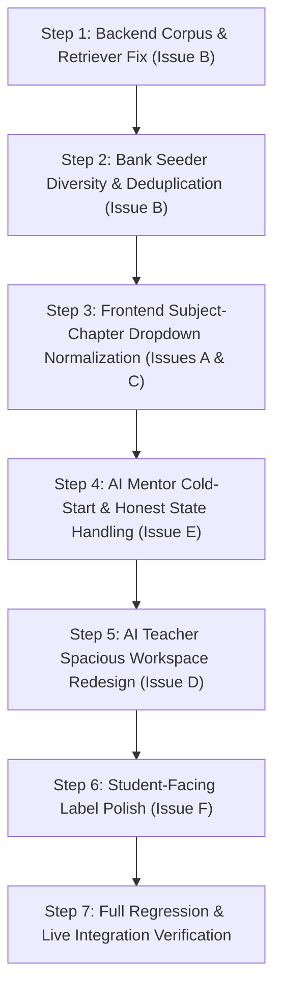

# GYAAN AI — STABILIZATION IMPLEMENTATION PLAN
## Stage B Proposed Action Roadmap (Pending Authorization)

**Document Identifier:** `GYAAN-AI-STABILIZATION-PLAN-v1.0`  
**Date:** November 14, 2026  
**Author:** Senior Principal Systems Architect  
**Project Path:** `D:\Gyaan AI`  
**Execution Condition:** **PLANNING ONLY. ZERO FILE EDITS AUTHORIZED UNTIL STAGE B APPROVAL.**  

---

## 1. IMPLEMENTATION PHILOSOPHY & NON-NEGOTIABLE BOUNDARIES

1. **Surgical, Minimal Changes:** Modify only lines directly responsible for the verified root causes.
2. **Zero Database Schema Changes:** The active SQLite database (`data/gyaan_ai.db`) schema and existing 793 student records remain completely untouched.
3. **Preserve All Eight Agents:** Every canonical CrewAI agent retains its independent prompt, role, backstory, task factory, and workflow registration.
4. **Zero Cloud Dependencies:** Maintain local Ollama `qwen2.5:3b` inference.
5. **Full Regression Safety:** Ensure all 248 unit/regression tests and all 9 live integration tests pass post-implementation.

---

## 2. PHASED IMPLEMENTATION SEQUENCE



---

## 3. DETAILED ACTION SPECIFICATIONS

### Step 1: Fix Resource Retriever Topic Verification (`backend/services/resource_retriever.py`)
- **Problem:** Adding `subject.lower()` ("science") to `query_terms` matches every entry's title, causing `is_verified=True` even when zero topic keywords match.
- **Proposed Modification:**
  - Separate `subject` filtering from `topic` keyword scoring.
  - Require `topic_match_score >= 2` (matching at least one substantive topic/chapter keyword) before declaring `is_verified = True`.
  - If only the subject matches, return `is_verified = False` and `source_type = "Provisional Curriculum Guidelines"`.
- **Add Missing NCERT Corpus:**
  - Add verified NCERT excerpts for Chapter 5 ("Life Processes") and other core chapters into `data/resources/ncert_class10_science.json` so genuine local references exist.

### Step 2: Fix Question Bank Seeder Diversity (`backend/services/curriculum_bank_seeder.py`)
- **Problem:** `seed_life_processes()` and `seed_light_reflection_refraction()` repeat the same question template 25 times in a loop.
- **Proposed Modification:**
  - Update `seed_life_processes()` to seed 25 distinct questions covering nutrition, human digestion, aerobic/anaerobic respiration, human circulatory system, and nephron excretion.
  - Update `seed_light_reflection_refraction()` to seed 25 distinct questions across reflection, spherical mirrors, refraction, lens formula, and power of lenses.
  - In `backend/services/diagnostic_service.py`, add deduplication check on question text before caching or returning.

### Step 3: Normalize Subject-Chapter Dropdowns (`frontend/app/diagnostic/page.tsx` & `practice/page.tsx`)
- **Problem:** Hardcoded `<option value="Mathematics">` fails `subjects.find(s => s.name === "Mathematics")` because DB names are `"Mathematics Standard"` and `"Mathematics Basic"`.
- **Proposed Modification:**
  - Normalize subject matching:
    ```typescript
    const subjectObj = subjects.find((s) =>
      s.name.toLowerCase() === selectedSubject.toLowerCase() ||
      (selectedSubject === "Mathematics" && s.category === "Mathematics")
    );
    ```
  - When subject changes, immediately clear `chapters`, fetch new chapters via `apiClient.getSubjectChapters(subjectObj.id)`, and set `selectedChapter = chList[0].title`.
  - Add fallback: if `selectedSubject === "Mathematics"`, populate default Class 10 Math chapters (`["Real Numbers", "Polynomials", ...]`).

### Step 4: AI Mentor Cold-Start Fast-Path & Responsive State (`backend/app/main.py` & `frontend/app/mentor/page.tsx`)
- **Problem:** Synchronous 90-second Ollama execution runs even when student has 0 completed assessments, producing empty recommendations and frozen loading card.
- **Proposed Modification:**
  - In `backend/app/main.py`:
    Check `objective_stats.get("has_sufficient_history")`. If `False` (0 assessments):
    Return an immediate, structured response:
    ```json
    {
      "mentor_overview": "Welcome to AI Mentoring! You have not completed any quizzes or diagnostics yet. Complete your first practice set so I can analyze your strengths and tailor personalized recommendations.",
      "recommendations": [],
      "study_tip": "Start by taking a 5-question quick quiz in Practice & Assessments.",
      "next_milestone": "Complete your first Class 10 assessment."
    }
    ```
    Duration: < 50ms (avoids 90-second Ollama freeze).
  - In `frontend/app/mentor/page.tsx`:
    Render an encouraging, clear onboarding view when `recommendations.length === 0` with a direct button: `[Take Practice Quiz]`.
    Add elapsed loading counter and 30s timeout handler.

### Step 5: AI Teacher Spacious Workspace Redesign (`frontend/app/teacher/page.tsx`)
- **Problem:** Double padding, fixed viewport calculations, and large static headers compress the message viewport.
- **Proposed Specification:**
  - **Outer Layout:** Eliminate inner `py-6` wrapper. Use full height flex column `flex-1 h-[calc(100vh-4.5rem)] overflow-hidden`.
  - **Compact Header:** Reduce header height to a single compact row with subject breadcrumbs, mode pill, and action buttons.
  - **Collapsible Curriculum Context:** Provide a sleek, collapsible single-line selector bar for Subject &rarr; Chapter &rarr; Topic.
  - **Expanded Message Canvas:** Full width message cards (`w-full max-w-4xl mx-auto`), comfortable line height, distinct student vs tutor card styling, and full LaTeX rendering width.
  - **Ergonomic Persistent Input:** Pinned bottom bar with auto-expanding textarea, keyboard shortcuts (`Enter` send, `Shift+Enter` newline), and quick question prompts.

### Step 6: Student-Facing Label Polish
- **Problem:** Technical tags like `"Orchestrated Multi-Agent System"`, `"qwen2.5:3b"`, `"Phase 8.6 Live"` exposed to students.
- **Proposed Replacements:**
  - `Orchestrated Multi-Agent System` &rarr; `AI Study Companion`
  - `qwen2.5:3b` &rarr; `Private Local AI`
  - `Executing specialized task across canonical agents via local Ollama...` &rarr; `Analyzing your question and preparing a step-by-step explanation...`
  - `Curriculum Agent • Phase 8.6 Live` &rarr; `Personalized 7-Day Study Plans`
  - `Mentor Agent • Phase 8.8 Live` &rarr; `Personalized Learning Coach`
  - `Resource Agent • Phase 8.7 Live` &rarr; `NCERT Verified Study Materials`

---

## 4. VERIFICATION & TEST PLAN

| Step | Verification Test | Command | Success Criteria |
|:---:|---|---|---|
| **1** | Resource Retriever Unit Test | `pytest tests/test_api_unit.py -k resources` | Life Processes returns `is_verified=False` when not in corpus; no chemical reaction contamination |
| **2** | Seeder & Deduplication Test | `pytest tests/test_curriculum_system.py` | 25 distinct questions verified in diagnostic sets; 0 duplicates |
| **3** | Subject-Chapter Mapping Test | `npm run build` & browser check | Selecting Mathematics loads Real Numbers, Polynomials; 0 Social Science chapters |
| **4** | Mentor Fast-Path Test | `pytest tests/test_progress_mentor_unit.py` | New student returns 200 OK within 100ms with honest onboarding guidance |
| **5** | Next.js Build & Lint | `cmd /c "cd frontend && npm run build"` | 16/16 routes compile cleanly with zero errors |
| **6** | Full Regression Suite | `pytest tests/ -m "not integration"` | 248 / 248 tests passed (100%) |
| **7** | Full Integration Suite | `pytest tests/ -m "integration"` | 9 / 9 live integration tests passed (100%) |
| **8** | Database Integrity Check | `sqlite3 PRAGMA integrity_check` | 793 students, 797 sessions intact; status `ok` |
