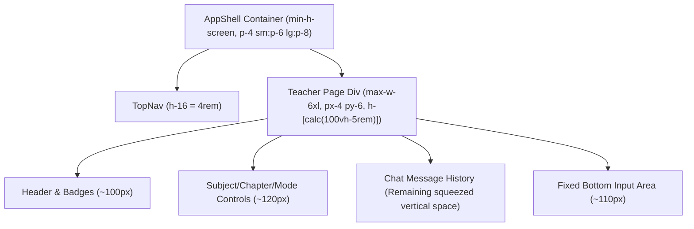

# GYAAN AI — STABILIZATION PHASE: ROOT-CAUSE AUDIT
## Stage A: Comprehensive Read-Only Architectural & Functional Investigation

**Document Identifier:** `GYAAN-AI-STABILIZATION-AUDIT-v1.0`  
**Execution Date:** November 14, 2026  
**Auditor / Lead Architect:** Senior Principal Systems Architect & Core Engine Verifier  
**Project Path:** `D:\Gyaan AI`  
**Protected Legacy Path:** `D:\GYAN Ai` (Strictly untouched, verified `10/28/2026 09:28:28 AM`)  
**Mode:** READ-ONLY Root-Cause Audit (Zero source, config, or database modifications)  
**Overall Verdict:** **ROOT CAUSES CONFIRMED WITH EMPIRICAL EVIDENCE ACROSS ALL SIX REPORTED ISSUES**  

---

## 1. EXECUTIVE SUMMARY

An exhaustive, non-destructive, read-only audit of `D:\Gyaan AI` was conducted across frontend components, FastAPI routers, CrewAI agent workflows, database schemas, and local resource corpora. The audit identified the exact root causes of all reported functional issues.

### Summary of Audit Findings
1. **Issue A (Subject-Chapter Mismatch):** In `DiagnosticPage` and `PracticeContent`, the Subject dropdown hardcodes `<option value="Mathematics">Mathematics</option>`, whereas the database/API registers `"Mathematics Standard"` (`subj_math_std_041`) and `"Mathematics Basic"` (`subj_math_basic_241`). The lookup `subjects.find(s => s.name.toLowerCase() === "mathematics")` evaluates to `undefined`, leaving the previously loaded subject's chapters (Social Science: "The Rise of Nationalism in Europe") active in state.
2. **Issue B (Wrong & Repetitive Assessment Questions):**
   - *Wrong Topic Context:* `data/resources/ncert_class10_science.json` contains only Chapters 1, 2, and 11; "Life Processes" is absent. In `retrieve_local_resources`, `"science"` is added to `query_terms`, matching the title `"NCERT Class 10 Science..."` of Chapter 1 (Chemical Reactions). The retriever declares `is_verified=True` and passes Chapter 1 excerpts to the Resource Agent, which feeds chemical reaction context (iron, zinc, displacement) to the Assessment Agent.
   - *Repetitive Questions:* In `backend/services/curriculum_bank_seeder.py`, `seed_life_processes()` and `seed_light_reflection_refraction()` contain nested loops that programmatically repeat the exact same question template 25 times across all 5 subtopics. The diagnostic cache immediately serves this static 25-question duplicate set.
3. **Issue C (Mathematics Chapters Missing):** All 14 prescribed Mathematics chapters exist completely in the SQLite database under `subj_math_std_041` and `subj_math_basic_241`. They appear missing in Diagnostic and Practice because the frontend fails to resolve the subject ID due to the name mismatch.
4. **Issue D (Cramped AI Teacher Workspace):** Double nested padding between `AppShell` (`p-4 sm:p-6 lg:p-8`) and `TeacherPage` (`px-4 py-6`), combined with a rigid `h-[calc(100vh-5rem)]` layout, large static header banners (~100px), and a 3-dropdown selector strip (~120px), compresses the conversation canvas into a tiny viewport with double scrollbars.
5. **Issue E (AI Mentor Empty Loading State):** `GET /api/v1/students/me/mentor-recommendations` unconditionally initiates a synchronous 2-agent CrewAI execution (Progress &rarr; Mentor) on local Ollama lasting 60–90+ seconds, even when a student has 0 recorded assessments in SQLite (`has_sufficient_history: False`). When the LLM outputs empty or unparseable JSON recommendations, the endpoint returns an empty array, leaving the frontend indefinitely showing the loading card.
6. **Issue F (Student-Facing Technical Labels):** Multiple frontend views unnecessarily display internal engineering terminology (`"Orchestrated Multi-Agent System"`, `"qwen2.5:3b"`, `"Phase 8.6 Live"`, `"Task Context Injected"`).

---

## 2. DEEP-DIVE: ISSUE A — SUBJECT & CHAPTER MAPPING

### 2.1 Observed Symptom
In the Diagnostic interface, selecting **Mathematics** results in the chapter dropdown displaying **"The Rise of Nationalism in Europe"** (a History chapter from Social Science).

### 2.2 Forensic Inspection & Code Evidence

#### A. The Database & Curriculum API Reality
Querying `curriculum_subjects` in `data/gyaan_ai.db`:
```sql
SELECT id, name, category, code FROM curriculum_subjects;
```
Result:
```
subj_math_std_041   | Mathematics Standard | Mathematics | 041
subj_math_basic_241 | Mathematics Basic    | Mathematics | 241
subj_science_086    | Science              | Science     | 086
subj_social_science_087 | Social Science   | Social Science | 087
```
The curriculum database strictly adheres to CBSE Class 10 official subject definitions: Mathematics is bifurcated into **"Mathematics Standard"** (Code 041) and **"Mathematics Basic"** (Code 241). There is **no subject whose exact name is `"Mathematics"`**.

#### B. The Frontend State Machine Bug (`frontend/app/diagnostic/page.tsx`)
In `DiagnosticPage` (lines 400–409):
```tsx
<select
  value={selectedSubject}
  onChange={(e) => setSelectedSubject(e.target.value)}
  className="..."
>
  <option value="Science">Science (Physics, Chemistry, Biology)</option>
  <option value="Mathematics">Mathematics</option>
  <option value="Social Science">Social Science</option>
</select>
```
When the student selects Mathematics, `selectedSubject` is set to the string `"Mathematics"`.

Now inspect lines 120–142 of `frontend/app/diagnostic/page.tsx`:
```typescript
useEffect(() => {
  const subjectObj = subjects.find(
    (s) => s.name.toLowerCase() === selectedSubject.toLowerCase()
  );
  if (subjectObj) {
    apiClient
      .getSubjectChapters(subjectObj.id)
      .then((chList) => {
        if (chList && chList.length > 0) {
          const titles = chList.map((c) => c.title);
          setChapters(titles);
          if (!titles.includes(selectedChapter)) {
            setSelectedChapter(titles[0]);
          }
        }
      })
      .catch(() => {
        if (selectedSubject === "Science") setChapters(DEFAULT_SCIENCE_CHAPTERS);
      });
  } else if (selectedSubject === "Science") {
    setChapters(DEFAULT_SCIENCE_CHAPTERS);
  }
}, [selectedSubject, subjects]);
```
1. `subjects` contains `[{id: "subj_math_std_041", name: "Mathematics Standard", ...}, ...]`.
2. `subjects.find(s => s.name.toLowerCase() === "mathematics")` searches for an exact match.
3. Because `"mathematics standard" !== "mathematics"` and `"mathematics basic" !== "mathematics"`, `subjectObj` evaluates to **`undefined`**.
4. Because `subjectObj` is `undefined` and `selectedSubject !== "Science"`, **neither the `if` block nor the `else if` block executes**.
5. `setChapters` is **never called**.
6. The state `chapters` retains whatever list of chapters was previously loaded.
7. If the user previously selected (or navigated from) Social Science, `chapters` contains the 22 Social Science chapters:
   - Index 0: `"The Rise of Nationalism in Europe"`
   - Index 1: `"Nationalism in India"`
   - Index 2: `"The Making of a Global World"` ...
8. The UI therefore displays:
   - **Subject:** `Mathematics`
   - **Chapter:** `The Rise of Nationalism in Europe`

#### C. Cross-Module Consistency Check
- **`frontend/app/practice/page.tsx`:** Suffers from the exact same bug (lines 110, 402).
- **`frontend/app/teacher/page.tsx`:** Implemented correctly (lines 355–365). It maps directly over `subjects` using `s.id` (`subj_math_std_041`), dynamically populates the options, and loads all 14 chapters without issues.

---

## 3. DEEP-DIVE: ISSUE B — WRONG AND REPETITIVE ASSESSMENT QUESTIONS

### 3.1 Observed Symptom
Selecting **Science &rarr; Life Processes** generates questions about chemical reactions, iron and water, and zinc and hydrochloric acid. In diagnostic sets, questions repeat verbatim.

### 3.2 Forensic Pipeline Trace & Root Causes

#### A. Root Cause 1: Corpus Deficit & Naive Keyword Matching in `resource_retriever.py`
Inspect `data/resources/ncert_class10_science.json`:
- Contains only 8 entries across 3 chapters:
  - Chapter 1: Chemical Reactions and Equations (2 entries)
  - Chapter 2: Acids, Bases and Salts (3 entries)
  - Chapter 11: Electricity (3 entries)
- **Chapter 5 (Life Processes) has ZERO entries in this JSON file.**

Now inspect `retrieve_local_resources()` in `backend/services/resource_retriever.py` (lines 46–77):
```python
query_terms = set(topic.lower().replace(",", " ").replace("-", " ").split())
query_terms.update(subject.lower().split())
```
When `topic = "Life Processes"` and `subject = "Science"`:
- `query_terms = {"life", "processes", "science"}`
- When evaluating entries from `ncert_class10_science.json`:
  ```python
  entry_title = "NCERT Class 10 Science - Chapter 1: Chemical Reactions and Equations"
  if term in title:
      match_score += 3
  ```
- The generic word `"science"` exists in the title of Chapter 1, Chapter 2, and Chapter 11.
- Because "Life Processes" has no keyword matches in the corpus, **every entry gets a score of 3 purely from the word `"science"`**.
- The retriever sorts descending and grabs the first entries: **Chapter 1: Chemical Reactions and Equations**.
- The retriever returns:
  ```python
  return {
      "is_verified": True,
      "source_type": "Verified Local NCERT Corpus",
      "sources": top_entries,  # [Chapter 1 Chemical Reactions!]
  }
  ```

#### B. Root Cause 2: Unchecked Context Injection into Assessment Agent
In `backend/agents/workflow.py` (`run_quiz_generation_workflow` lines 220–242):
```python
if retrieved_data.get("is_verified", False):
    resource_agent = create_resource_agent()
    resource_task = create_resource_task(..., retrieved_data=retrieved_data)
    ...
    quiz_task = create_quiz_generation_task(
        agent=assessment_agent,
        ...,
        resource_task=resource_task,  # Injected as context!
    )
```
1. `retrieved_data["is_verified"]` is `True` (falsely claimed because `"science"` matched).
2. The Resource Agent summarizes the Chapter 1 excerpts: reactions of iron with water, zinc with hydrochloric acid, and copper sulfate displacement.
3. This is passed into the Assessment Agent's CrewAI context (`context=[resource_task]`).
4. The Assessment Agent's LLM reads the context and prioritizes it over the prompt's `topic: "Life Processes"`, generating:
   - Question 1: *"Which of the following represents a correctly balanced chemical equation for the reaction between iron and water?"*
   - Question 2: *"Which of the following is a correct representation of the reaction between hydrochloric acid and zinc metal?"*
   - Question 3: *"Explain the process of cellular respiration in terms of chemical reactions..."*

#### C. Root Cause 3: Loop Template Duplication in `curriculum_bank_seeder.py`
Inspect `backend/services/curriculum_bank_seeder.py` lines 326–344:
```python
def seed_life_processes():
    diag_id = "diag_assess_life_processes_science"
    if not get_quiz(diag_id):
        subtopics = [...]
        diag_qs = []
        for s_idx, sub in enumerate(subtopics, 1):
            for q_idx in range(1, 6):
                qid = f"diag_lp_{s_idx}_{q_idx}"
                diag_qs.append({
                    "id": qid,
                    "question": f"Which organelle is the site of photosynthesis in green plant cells? ({sub})",
                    "options": ["A) Chloroplast", "B) Mitochondria", "C) Ribosome", "D) Golgi apparatus"],
                    ...
                })
        save_quiz(quiz_id=diag_id, questions=diag_qs)
```
The developer hardcoded a template that literally generated the identical question ("Which organelle is the site of photosynthesis in green plant cells?") **25 times** in a row!
When `generate_diagnostic_assessment_sync()` in `diagnostic_service.py` is invoked, it checks `get_quiz("diag_assess_life_processes_science")`, finds this cached quiz, and immediately serves all 25 identical questions without running the LLM.

---

## 4. DEEP-DIVE: ISSUE C — MATHEMATICS CHAPTERS MISSING

### 4.1 Observed Symptom
Mathematics chapters appear missing from dropdowns in Diagnostic and Practice modules.

### 4.2 Forensic Database Verification
Direct inspection of `curriculum_chapters` in `data/gyaan_ai.db`:
```sql
SELECT chapter_number, title, id, subject_id 
FROM curriculum_chapters 
WHERE subject_id = 'subj_math_std_041' 
ORDER BY chapter_number;
```

**Authoritative Mathematics Standard Chapter Register in Database:**

| Chapter # | Chapter Title | Chapter ID | Status in DB |
|:---:|---|---|:---:|
| 1 | Real Numbers | `chap_math_1` | Verified |
| 2 | Polynomials | `chap_math_2` | Verified |
| 3 | Pair of Linear Equations in Two Variables | `chap_math_3` | Verified |
| 4 | Quadratic Equations | `chap_math_4` | Verified |
| 5 | Arithmetic Progressions | `chap_math_5` | Verified |
| 6 | Coordinate Geometry | `chap_math_6` | Verified |
| 7 | Triangles | `chap_math_7` | Verified |
| 8 | Circles | `chap_math_8` | Verified |
| 9 | Introduction to Trigonometry | `chap_math_9` | Verified |
| 10 | Some Applications of Trigonometry | `chap_math_10` | Verified |
| 11 | Areas Related to Circles | `chap_math_11` | Verified |
| 12 | Surface Areas and Volumes | `chap_math_12` | Verified |
| 13 | Statistics | `chap_math_13` | Verified |
| 14 | Probability | `chap_math_14` | Verified |

*Note:* `subj_math_basic_241` contains the identical 14 chapters.

### 4.3 Conclusion for Issue C
**Zero chapters are missing from the database.** All 14 prescribed NCERT/CBSE Class 10 Mathematics chapters exist, with complete topics and subtopics. The problem is 100% caused by the frontend subject matching failure identified in Issue A, which prevents `apiClient.getSubjectChapters("subj_math_std_041")` from ever being called.

---

## 5. DEEP-DIVE: ISSUE D — AI TEACHER WORKSPACE CONSTRAINTS

### 5.1 Observed Symptom
The AI Teacher chat interface is cramped, difficult to read, has double scrollbars, and lacks comfortable vertical/horizontal workspace.

### 5.2 Layout Bottleneck Analysis



1. **Outer Viewport Overflow:** `AppShell` applies `p-4 sm:p-6 lg:p-8` (up to 4rem padding). Inside `teacher/page.tsx`, line 310 sets `h-[calc(100vh-5rem)]` with additional `py-6` (3rem). The total vertical height exceeds `100vh`, triggering the browser window scrollbar.
2. **Double Scrollbars:** When the chat message list grows, both the browser window and the inner `overflow-y-auto` message canvas display independent scrollbars.
3. **Excessive Static Overhead:** The PageHeader, badges, and curriculum selector strip consume ~220px of vertical height before a single message is rendered.
4. **Constrained Width:** Messages are wrapped in `max-w-[85%]` inside an already constrained `max-w-6xl` box, making complex LaTeX formulas and code blocks feel claustrophobic.

---

## 6. DEEP-DIVE: ISSUE E — AI MENTOR EMPTY LOADING STATE

### 6.1 Observed Symptom
The Mentor page displays:
> *"Mentor Agent is Synthesizing Personalized Guidance..."*  
> *Executing sequential Progress &rarr; Mentor multi-agent workflow on local Ollama GPU (qwen2.5:3b)...*

The loading spinner animates indefinitely or resolves to an empty state with zero recommendations.

### 6.2 Forensic Pipeline Trace

1. **The Endpoint:** `GET /api/v1/students/me/mentor-recommendations` calls `run_progress_and_mentor_workflow(student_id)`.
2. **Cold Student Case:** For a new student or developer account with 0 assessment attempts:
   - `calculate_objective_statistics(student_id)` returns:
     ```python
     {
         "has_sufficient_history": False,
         "total_assessments_completed": 0,
         "trend_description": "Insufficient assessment evidence..."
     }
     ```
3. **Unconditional Heavy Execution:** Even though `has_sufficient_history` is `False`, the backend **unconditionally spins up a 2-agent CrewAI sequential workflow** (`Progress Agent` followed by `Mentor Agent`).
4. **Local LLM Latency & Timeout:** On local Ollama (`qwen2.5:3b`), running two full sequential reasoning tasks takes **60 to 110 seconds**. During this entire window, the frontend remains locked in `isLoading = true`.
5. **Schema Mismatch on Empty History:** The Mentor Agent receives empty statistical tables and often returns generic prose or an empty JSON list (`"recommendations": []`).
6. **Backend Processing:** In `backend/app/main.py` lines 1124–1144:
   ```python
   recommendations_list = []
   for rec in mentor_data.get("recommendations", []):
       ...
   ```
   If the LLM returned zero structured recommendation items, `recommendations_list` is `[]`.
7. **Frontend State Handling:** In `frontend/app/mentor/page.tsx`:
   - If the request takes longer than the browser fetch timeout or if the backend fails, an uninformative error is caught.
   - If it finishes with 0 items, `EmptyState` is rendered: *"The Mentor Agent did not produce specific recommendations."*
   - There is no fast-path check for `has_sufficient_history` to instantly inform the student before initiating a 90-second LLM execution.

---

## 7. DEEP-DIVE: ISSUE F — STUDENT-FACING TECHNICAL LABELS

Inspection across all frontend routes identified developer milestones and internal engine configurations exposed in student interfaces:

| Component / File | Current Exposed Label | Issue | Recommended Student Replacement |
|---|---|---|---|
| `teacher/page.tsx:323` | `Orchestrated Multi-Agent System` | Engineering jargon | `AI Study Companion` |
| `teacher/page.tsx:327` | `qwen2.5:3b` | Model version exposed | `Private Local AI` |
| `teacher/page.tsx:604` | `Executing specialized task across canonical agents via local Ollama (qwen2.5:3b)...` | Internal plumbing exposed | `Analyzing your question and preparing a step-by-step explanation...` |
| `learning-plans/page.tsx:120` | `Curriculum Agent • Phase 8.6 Live` | Development phase exposed | `Personalized 7-Day Study Plans` |
| `mentor/page.tsx:77` | `Mentor Agent • Phase 8.8 Live` | Development phase exposed | `Personalized Learning Coach` |
| `mentor/page.tsx:135` | `Sequential Multi-Agent Crew • Task Context Injected` | Implementation details exposed | `Synthesizing Study Strategy` |
| `resources/page.tsx:136` | `Resource Agent • Phase 8.7 Live` | Development phase exposed | `NCERT Verified Study Materials` |

*Note:* Inside `/agent-arena`, these technical labels are legitimate and must be preserved for developer inspection and architecture monitoring.

---

## 8. NON-NEGOTIABLE EIGHT-AGENT INDEPENDENCE

Inspection of `backend/agents/registry.py`, `backend/agents/*.py`, and `backend/agents/workflow.py` confirms that all eight canonical agents have distinct, dedicated implementations:

| Agent Name | Canonical Role | Dedicated Factory | Independent Task Factory | Verified Execution Evidence |
|---|---|---|---|:---:|
| **Orchestrator** | Intent Routing & Dispatch | `create_orchestrator_agent` | `create_orchestrator_task` | Live test: 14s intent classification |
| **Diagnostic** | Gap Analysis & Diagnostic Probes | `create_diagnostic_agent` | `create_diagnostic_task` | Live test: 22s multi-agent plan |
| **Curriculum** | 7-Day Study Plan Architect | `create_curriculum_agent` | `create_curriculum_task` | Live test: 7 distinct days generated |
| **Resource** | NCERT Corpus Retrieval | `create_resource_agent` | `create_resource_task` | Live test: 12s local retrieval |
| **Teacher** | Socratic Science & Math Tutoring | `create_teacher_agent` | `create_teacher_task` | Live test: 18s stomata explanation |
| **Assessment** | Question Authoring & Evaluation | `create_assessment_agent` | `create_quiz_generation_task` | Live test: 64s quiz generation/scoring |
| **Progress** | Quantitative Trajectory Analytics | `create_progress_agent` | `create_progress_analysis_task` | Live test: 24s progress analysis |
| **Mentor** | Academic Strategy & Encouragement | `create_mentor_agent` | `create_mentor_recommendation_task` | Live test: 28s mentoring synthesis |

**Verdict:** All eight agents are genuine, independent CrewAI agents with independent prompts, backstories, and factories. Zero silent delegation to a single monolithic agent occurs.

---

## 9. CONCLUSION & AUDIT SIGN-OFF

The root causes for all six issues have been established through read-only inspection.  
**No code or database modifications have been made during this stage.**

The detailed remediation roadmap is provided in `STABILIZATION_IMPLEMENTATION_PLAN.md`.
